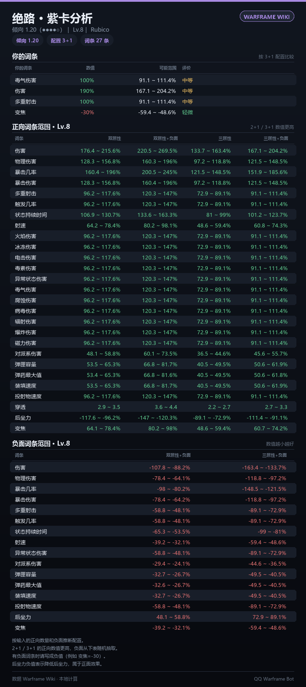

# QQ Warframe 查询机器人 v2

一个跑在自己电脑上的 QQ 机器人：查武器、战甲、MOD、赋能、遗物、套装等**所有可交易物品**的实时报价与行情，支持**套装拆件比价、紫卡、紫卡分析、Baro 奸商、突击、仲裁、中文维基、降价提醒**，所有缓存数据后台自动更新。

**所有查询结果都以图片卡片发送**（深色 Warframe 风格），文字只作为图片不可用时的兜底。

- 市场数据：<https://warframe.market/zh-hans/>（官方 API v2，简体中文名）
- 世界状态：<https://api.warframestat.us>（奸商/突击/仲裁）
- 中文维基：<https://warframe.huijiwiki.com/>
- QQ 接入：OneBot 11（NapCatQQ / LLOneBot / Lagrange.OneBot）
- 运行环境：Python 3.8+，仅依赖 Pillow（已装则开箱即用）
- Linux 一键部署：NapCat + Xray（VLESS 节点）+ 机器人，见 [LINUX.md](LINUX.md)
- Linux 部署：见 [LINUX.md](LINUX.md)（一键脚本 / Docker / systemd 三种方式）
- 功能设计参考了社区的 [NyxBot](https://github.com/KingPrimes/NyxBot) 等项目


| 拆件比价 | 紫卡分析 |
| --- | --- |
|  |  |

| 仲裁评级 | 仲裁任务 |
| --- | --- |
|  |  |

| 奸商 | 中文维基 |
| --- | --- |
|  |  |

---

## 功能

| 模块 | 说明 |
| --- | --- |
| 物品查询 | 类型、杜卡德、MR、交易税、英文名、市场链接 |
| 实时报价 | 在线卖家/买家、价格、数量、MOD 等级、游戏内状态 |
| 成交行情 | 48 小时 / 90 天均价、中位价、区间、成交量，外加近 15 天逐日价格表 |
| 中文搜索 | 中文名、英文名、slug、外号、`绝路p` 简写 |
| 拆件比价 | 把套装拆成部件逐个查价，对比“买套 vs 买件” |
| 紫卡 | 武器倾向、紫卡类型、拍卖行在售（接口可用时） |
| 紫卡分析 | 本地按 Warframe Wiki 公式计算；所有武器倾向默认固定 1.20 |
| 世界状态 | Baro 奸商库存、每日突击、仲裁（游戏已移除传统警报） |
| 仲裁评级 | arbi.wf.wiki 的节点梯队（S/A+/A/A-/C）、当前节点评级、轮换兜底 |
| 多平台 | `pc / ps / xbox / switch / mobile` 价格 |
| 降价提醒 | 设定目标价，后台每 5 分钟检查并推送图片 |
| 自动更新 | 后台每 6 小时刷新市场索引、紫卡武器表、仲裁评级 |
| 短缓存 | 订单 60 秒、行情 15 分钟、世界状态 60 秒、维基 10 分钟，重复查询秒回 |
| 中文维基 | 词条摘要图片 + 直达链接 |
| 稳定性 | 12h 物品缓存、3 请求/秒限流、429 重试、断线重连 |

---

## 命令

| 命令 | 作用 |
| --- | --- |
| `#查 <名称> [平台]` | 物品详情 + 买卖单 + 行情 + 近 15 天走势表 |
| `#价格 <名称> [平台]` | 只看价格：更多买卖单 + 行情 |
| `#战甲 / #武器 / #mod <名称>` | 分类搜索 |
| `#拆件 <套装名> [平台]` | 套装拆件比价 |
| `#紫卡 <武器名> [平台]` | 紫卡倾向 + 拍卖 |
| `#紫卡分析 <武器> [词条=数值 ...]` | 本地计算词条范围 + roll 评分 |
| `#奸商` | Baro 奸商位置、倒计时、库存 |
| `#突击` / `#仲裁` | 每日突击 / 当前仲裁（含节点评级） |
| `#仲裁评级` | 仲裁节点梯队表（S/A+/A/A-/C） |
| `#提醒 <名称> <目标价> [平台]` | 添加降价提醒 |
| `#提醒列表` | 查看本会话的提醒 |
| `#取消提醒 <编号\|all>` | 取消提醒 |
| `#更新` | 立即后台刷新所有缓存（含短缓存，10 分钟冷却） |
| `#数据状态` | 查看各数据源的条数与更新时间 |
| `#wiki <关键词>` | 中文维基摘要 |
| `#帮助` | 指令菜单 |

紫卡分析用法：

```text
#紫卡分析 绝路                                   全部词条范围（2/3 正向、2+1/3+1、负面）
#紫卡分析 绝路 伤害=165 多重=90                   评估具体 roll
#紫卡分析 绝路 伤害=165 多重=90 变焦=-30          带负面
```

- 数值带负号表示负面；不写负面时按“无负面”配置比较。
- 支持中文/英文词条名和常用缩写（伤害、多重、暴击、暴伤、触发、射速、攻速…）。
- 「后坐力」比较特殊：负值表示降低后坐力，属于正面效果。

细节：

- 前缀 `#` / 全角 `＃` 都行，`#查绝路` 这种不加空格的写法也能识别。
- 群里 **@机器人 + 内容** 可以不带前缀，例如 `@机器人 查 绝路`。
- 平台写在名称最后：`#价格 绝路 ps`、`#查 牛甲 xbox`，默认 PC。
- 名称支持中文、英文、外号；`绝路p`、`mesa p` 会当成 `prime`。
- 只有可交易物品才会出现在市场里（普通战甲本体、任务钥匙等不可交易）。

---

## 快速开始

### 1. 环境

- Python 3.8+（你机器上已有 3.8.6）
- Pillow（已安装；若换机器：`pip install Pillow`）
- QQ 小号 + [NapCatQQ](https://github.com/NapNeko/NapCatQQ)（或 LLOneBot / Lagrange.OneBot）
- **代理**：默认使用 v2rayN 的 HTTP 代理 `http://127.0.0.1:10809`

### 2. 配置 NapCat

1. 启动 NapCat 并用小号登录。
2. 「网络配置」→ 新建 → **WebSocket 服务器**：
   - 端口 `3001`
   - Token 自定义（例如 `my-secret-token`），也可以留空
   - 消息格式 `array` / `string` 都兼容
3. 保存并启用。

### 3. 配置机器人

```bash
cd qqwarframe-bot
python run.py
```

（Windows 可双击 **`start.bat`**。）

第一次运行会生成 `config.json`。打开它，确认：

```json
"onebot": {
  "ws_url": "ws://127.0.0.1:3001",
  "access_token": "my-secret-token"
},
"warframe_market": {
  "proxy": "http://127.0.0.1:10809"
}
```

### 4. 自检

```bash
python selftest.py
```

（Windows 可双击 **`check.bat`**。）会依次检查：图片渲染、物品索引、中文名覆盖、
报价与行情、紫卡数据、紫卡分析、世界状态、中文维基。核心项全部 `OK` 即可启动；
维基如果被 Cloudflare/WAF 拦截会显示 `WARN`，不影响其他功能。

### 5. 启动

```bash
python run.py
```

看到 `已连接 OneBot 服务` 后，在群里发 `#帮助`。停止：`Ctrl + C`。

---

## Linux 部署

代码本身跨平台；Linux 提供 **一键部署（NapCat + Xray + 机器人）**、直接运行、
Docker、systemd 四种方式。项目里已经带了这些文件：

```text
deploy/oneclick.sh              # 一键部署（含 NapCat 与代理）
docker-compose.full.yml         # napcat + xray + bot
deploy/vless_to_xray.py         # VLESS 链接转 Xray 配置
xray/config.json                # 已按你的节点生成（含凭据，600）
install.sh  start.sh  check.sh
Dockerfile  docker-compose.yml  .dockerignore
deploy/qqwarframe-bot.service
deploy/docker-entrypoint.sh
```

### 方式 0：一键部署（NapCat + 代理 + 机器人）

```bash
sudo ./deploy/oneclick.sh
```

脚本会安装/启动 Docker、生成 `.env`、用 `deploy/vless.txt` 生成
`xray/config.json`，然后启动三个容器：

| 容器 | 作用 |
| --- | --- |
| `napcat` | QQ 协议端，WebUI `127.0.0.1:6099`，WS `3001`（仅容器网络） |
| `xray` | 你的 VLESS Reality 节点 → 本地 HTTP 代理 `10809`（仅容器网络） |
| `bot` | 机器人，连 `ws://napcat:3001`，走 `http://xray:10809` |

完成后按脚本提示：打开 WebUI 扫码登录 QQ → 确认 WS 服务器 3001 →
`docker compose -f docker-compose.full.yml logs -f bot` → 群里发 `#帮助`。

- WebUI 默认只绑 `127.0.0.1`，远程服务器用
  `ssh -L 6099:127.0.0.1:6099 root@服务器IP` 转发。
- 若在 NapCat WebUI 里设置了 WS Token，把它写进 `.env` 的
  `NAPCAT_WS_TOKEN=`，再重启 bot 容器。
- **`xray/config.json` 和 `deploy/vless.txt` 含节点凭据（权限 600），
  不要把压缩包或目录分享给别人。**
- 换节点：修改 `deploy/vless.txt` 后运行
  `python3 deploy/vless_to_xray.py --file deploy/vless.txt --output xray/config.json`，
  再 `docker compose -f docker-compose.full.yml restart xray`。

### 方式 A：直接跑（推荐先试）

```bash
# Debian / Ubuntu：Python、虚拟环境、中文字体
sudo apt update
sudo apt install -y python3 python3-venv fonts-noto-cjk

# Fedora：sudo dnf install python3 python3-pip google-noto-sans-cjk-fonts
# Arch：  sudo pacman -S python python-pip noto-fonts-cjk

cd qqwarframe-bot
chmod +x install.sh start.sh check.sh
./install.sh          # 建 .venv、装 Pillow、生成 config.json
nano config.json      # 填 ws_url / access_token / proxy
./check.sh            # 联网自检
./start.sh            # 启动
```

- 无桌面环境的服务器也能跑，图片由 Pillow 在本地画。
- 如果 `check.sh` 显示“图片渲染 FAIL”，就是缺中文字体，装 `fonts-noto-cjk`。
- 后台常驻用 `nohup`/`tmux` 也可以，但更推荐下面的 systemd。

### 方式 B：Docker（最省事）

```bash
cd qqwarframe-bot
mkdir -p config data logs
docker compose up -d --build
docker compose logs -f
```

- 默认 `network_mode: host`：容器里的 `127.0.0.1` 就是宿主机，
  NapCat 和代理都按本机地址填。
- 首次启动自动生成 `config/config.json`，可直接在宿主机编辑。
- 也可以用环境变量覆盖（优先级高于 json）：
  `QQWF_WS_URL`、`QQWF_ACCESS_TOKEN`、`QQWF_PROXY`、`QQWF_PLATFORM`、
  `QQWF_IMAGE`、`QQWF_ALERTS`、`QQWF_WORLDSTATE`、`QQWF_AUTO_UPDATE`、
  `QQWF_CACHE`、`QQWF_RIVEN_DISPOSITION`、`QQWF_ARBI_PROXY`、`QQWF_LOG_LEVEL`。
- 镜像内置 `fonts-noto-cjk`，不需要在宿主机装字体。
- 如果 NapCat 是同一 compose 里的另一个容器：删掉 `network_mode`，
  按 `docker-compose.yml` 注释启用 bridge 网络，`ws_url` 改成 `ws://napcat:3001`。

### 方式 C：systemd 常驻

```bash
sudo useradd -r -s /usr/sbin/nologin qqwarframe
sudo mkdir -p /opt/qqwarframe-bot
sudo cp -r . /opt/qqwarframe-bot
sudo chown -R qqwarframe:qqwarframe /opt/qqwarframe-bot
cd /opt/qqwarframe-bot && sudo -u qqwarframe ./install.sh

sudo cp deploy/qqwarframe-bot.service /etc/systemd/system/
sudo systemctl daemon-reload
sudo systemctl enable --now qqwarframe-bot
sudo journalctl -u qqwarframe-bot -f
```

服务文件默认用 `/opt/qqwarframe-bot/.venv/bin/python`，路径不同就改 `ExecStart`。

### Linux 上的 NapCat

NapCat 官方提供 Linux / Docker 版本。Docker 方式通常是：

```bash
docker run -d --name napcat --restart unless-stopped \
  --network host \
  -v "$PWD/napcat/config:/app/napcat/config" \
  mlikiowa/napcat-docker:latest
```

（镜像名和挂载路径以 NapCat 官方文档为准。）WebUI 默认 6099，登录后到
「网络配置」添加 WebSocket 服务器，端口 3001。

### Linux 上的代理

- v2rayA / Clash / sing-box 的 HTTP 端口不一定是 10809，
  改 `config.json` 里 `warframe_market.proxy`、`wiki.proxy`、`worldstate.proxy`。
- Clash 常见 `http://127.0.0.1:7890`；只给市场挂代理时其余填 `"none"`。
- Docker 用 host 网络时照常写 `127.0.0.1`；bridge 网络要写宿主机地址。
- 代理端口没监听时，`run.py` 启动会打印警告。

---

## 代理说明（重要）

warframe.market 和 warframestat 在国内直连经常超时/403，**默认配置已经帮你挂好 v2rayN 的 HTTP 代理**：

```json
"warframe_market": { "proxy": "http://127.0.0.1:10809" },
"wiki":            { "proxy": "http://127.0.0.1:10809" },
"worldstate":      { "proxy": "http://127.0.0.1:10809" }
```

- 你的 v2rayN 必须处于运行状态，且「HTTP 代理」端口是 `10809`（v2rayN 默认）。
- 如果改过端口：把三处 `10809` 改成实际端口（例如 Clash 常用 `7890`）。
- 想强制直连（不走任何代理）：把 `proxy` 改成 `"none"`。
- 只给市场挂代理、维基直连也可以，把 `wiki.proxy` / `worldstate.proxy` 设为 `"none"`。

`selftest.py` 会显示当前使用的代理；如果报“无法连接”或 403，先确认 v2rayN 是否在运行。

---

## 配置项

### onebot

| 字段 | 默认 | 说明 |
| --- | --- | --- |
| `ws_url` | `ws://127.0.0.1:3001` | NapCat WebSocket 地址 |
| `access_token` | `""` | 与 NapCat Token 一致 |
| `reconnect_min_seconds` / `reconnect_max_seconds` | 1 / 60 | 断线重连退避 |
| `heartbeat_seconds` / `heartbeat_timeout_seconds` | 25 / 75 | 心跳与超时 |
| `api_timeout_seconds` | 15 | 发送接口超时 |

### behavior

| 字段 | 默认 | 说明 |
| --- | --- | --- |
| `prefixes` | `["#", "＃"]` | 命令前缀 |
| `allow_private` | `true` | 是否响应私聊 |
| `respond_to_at` | `true` | @机器人 可免前缀 |
| `at_sender` | `true` | 回复时 @ 提问者 |
| `whitelist_groups` / `blacklist_groups` | `[]` | 群白/黑名单 |
| `cooldown_seconds` | 3 | 每用户冷却 |
| `max_replies_per_minute` | 20 | 每会话每分钟上限 |
| `max_reply_chars` | 1200 | 文字兜底分片长度 |
| `preload_items` | true | 启动预热物品索引 |

### warframe_market

| 字段 | 默认 | 说明 |
| --- | --- | --- |
| `base_url` | `https://api.warframe.market` | API 地址 |
| `language` | `zh-hans` | 物品语言 |
| `platform` | `pc` | 默认平台 |
| `crossplay` | true | 包含跨平台订单 |
| `max_requests_per_second` | 3 | 官方限制，别调高 |
| `retries` | 2 | 429/5xx 重试 |
| `proxy` | `http://127.0.0.1:10809` | 代理；`"none"` 直连 |
| `insecure_tls` | false | 证书异常时才开 |
| `cache_ttl_seconds` | 43200 | 物品索引缓存 12 小时 |
| `cache_file` | `data/items_cache.json` | 缓存路径 |
| `alias_file` | `data/aliases.json` | 外号表 |
| `top_orders` / `price_orders` | 5 / 8 | 卡片显示买卖单数 |

### wiki

| 字段 | 默认 | 说明 |
| --- | --- | --- |
| `api_url` | huijiwiki 的 `api.php` | 想换 B 站 WIKI 改这里 |
| `site_url` | huijiwiki 的 `/wiki/` | 词条链接前缀 |
| `summary_chars` | 280 | 摘要字数 |
| `proxy` | `http://127.0.0.1:10809` | 代理 |
| `cookie` | `""` | 浏览器 Cookie（含 `cf_clearance`），用于绕过 Cloudflare |
| `fallback_bwiki` | true | huijiwiki 失败时自动尝试 BWIKI |
| `bwiki_base` | `https://wiki.biligame.com/warframe` | BWIKI 地址 |

### worldstate

| 字段 | 默认 | 说明 |
| --- | --- | --- |
| `enabled` | true | 关闭后 `#奸商/#突击/#仲裁` 提示未启用 |
| `base_url` | `https://api.warframestat.us` | 世界状态 API |
| `language` | `zh` | 请求中文 |
| `proxy` | `http://127.0.0.1:10809` | 该站有 Cloudflare，建议走代理 |

### 紫卡分析

`#紫卡分析` 完全本地计算，不请求第三方紫卡站。公式来自
[Warframe Wiki · Riven Mods](https://wiki.warframe.com/w/Riven_Mods)：

```text
最终值 = 基础值 × random(0.90 ~ 1.10) × 紫卡倾向 × 权重
```

| 配置 | 正向权重 | 负面权重 |
| --- | --- | --- |
| 2 正向 | 0.99 | — |
| 2 正向 + 负面 | 1.2375 | -0.495 |
| 3 正向 | 0.75 | — |
| 3 正向 + 负面 | 0.9375 | -0.75 |

基础值按武器类别（步枪/霰弹/手枪/空战/近战）取自 Wiki 的
“Attributes and their base value”表。倾向默认**全局固定为 1.20**，
由 `riven.disposition_override` 控制；设为 `0` 可恢复 warframe.market 的实际倾向。

- 物理伤害、对派系伤害按游戏内合并词条展示；火焰/冰冻/电击/毒素分开。
- 融合词条已加入：异常状态伤害、毒气/腐蚀/病毒/辐射/爆炸/磁力；基础值 90，
  近战只有异常状态伤害。3+1、倾向 1.2 时：`90 × 0.9375 × 1.2 × 0.9~1.1 = 91.1~111.4%`。
- 组合枪（Kitgun）按手枪基础值；空战武器按空战列；Zaw 按近战。
- 数值保留一位小数，和游戏内显示可能差 0.1。

### riven

| 字段 | 默认 | 说明 |
| --- | --- | --- |
| `disposition_override` | 1.2 | 所有武器的紫卡倾向统一按该值计算；`0` 表示使用市场实际值 |

### arbi

| 字段 | 默认 | 说明 |
| --- | --- | --- |
| `enabled` | true | 关闭后 `#仲裁评级` 提示未启用 |
| `base_url` | `https://arbi.wf.wiki` | 仲裁评级站点 |
| `proxy` | `http://127.0.0.1:10809` | 访问该站用；也支持直连 |
| `cache_seconds` | 21600 | 评级数据缓存（6 小时） |

### image

| 字段 | 默认 | 说明 |
| --- | --- | --- |
| `enabled` | true | 关闭后全部发文字 |
| `font` / `font_bold` | `""` | 自定义字体路径；留空自动找微软雅黑 |

### alerts

| 字段 | 默认 | 说明 |
| --- | --- | --- |
| `enabled` | true | 降价提醒总开关 |
| `file` | `data/alerts.json` | 提醒持久化文件 |
| `check_seconds` | 300 | 检查间隔（最小 60 秒） |
| `max_per_chat` | 20 | 每个群/私聊最多条数 |

### auto_update

| 字段 | 默认 | 说明 |
| --- | --- | --- |
| `enabled` | true | 后台自动更新总开关 |
| `interval_seconds` | 21600 | 刷新间隔（6 小时，最小 300 秒） |
| `on_start` | true | 启动后先做一次轻量刷新（用缓存/过期才拉） |
| `market` / `riven` / `arbi` | true | 分别控制三个数据源 |
| `manual_cooldown_seconds` | 600 | `#更新` 的冷却时间 |

实时数据每次查询会先走短缓存（见下节），过期后才重新请求；`#更新` 会同时清空短缓存。

### cache

| 字段 | 默认 | 说明 |
| --- | --- | --- |
| `enabled` | true | 短缓存总开关 |
| `item_seconds` | 3600 | 物品详情缓存 |
| `orders_seconds` | 60 | 买卖单缓存 |
| `stats_seconds` | 900 | 48h/90 天行情缓存 |
| `riven_seconds` | 300 | 紫卡拍卖缓存 |
| `worldstate_seconds` | 60 | 奸商/突击/仲裁缓存 |
| `wiki_seconds` | 600 | 维基词条缓存 |

想每次都拿最新数据，把对应秒数改成 `0` 即可关闭该项缓存；`#更新` 会立即清空所有短缓存。

---

## 图片卡片

- 用 Pillow 现画，不依赖浏览器或外部服务；宽度固定 860px，高度自适应。
- 中文字体自动查找：微软雅黑（`msyh.ttc`）→ 黑体（`simhei.ttf`）→ Noto/文泉驿。
  找不到字体或 Pillow 时会自动**退回文字**，不会导致机器人崩溃。
- 图片以 `base64://` 形式通过 OneBot 发送，NapCat 在 Docker 里也能收到。
- 想换字体：把 ttc/ttf 路径填到 `image.font` / `image.font_bold`。

---

## 降价提醒

```text
#提醒 绝路 50          → 目标价 ≤ 50p（PC）
#提醒 Mesa ps 80        → PlayStation，目标 ≤ 80p
#提醒列表
#取消提醒 ab12
```

- 后台每 5 分钟检查一次，**达到目标价时推送一张图片卡片**，然后自动关闭该条提醒。
- 提醒保存在 `data/alerts.json`，重启机器人不丢。
- 每个会话最多 20 条；同一物品同一平台不能重复添加。
- 检查请求也受 3 次/秒限流保护。

---

## 测试

```bash
python -m unittest discover -s tests -t . -v
```

**243 个离线测试**，不联网、不连 QQ，覆盖：

- WebSocket 握手/掩码/分片/ping-pong
- 中文/英文/外号搜索排序、平台参数、拆件与紫卡逻辑
- 本地紫卡公式、词条别名、2/3 正向与负面范围、roll 评分
- 仲裁评级 JSON 解析、节点查找、轮换兜底
- 市场响应解析、48h 统计聚合、缓存、429 重试
- 维基摘要与 HTML 回退、世界状态时间解析
- 提醒存储的增删改查与持久化
- 自动更新调度、手动触发冷却、数据源状态汇总
- 短 TTL 缓存的命中/过期、各数据源缓存包装
- 图片卡片的 PNG 尺寸与长文本换行
- **端到端**：mock OneBot 服务端 + mock 市场/Wiki，验证收事件、发图片、@ 回复

---

## 目录结构

```text
qqwarframe-bot/
├── run.py                 # 启动入口
├── selftest.py            # 联网自检
├── config.example.json    # 配置模板
├── start.bat / check.bat  # Windows 快捷方式
├── start.sh  / check.sh   # Linux / macOS 快捷方式
├── install.sh             # Linux 一键安装（venv + Pillow + 配置）
├── Dockerfile             # Linux 容器镜像（内置中文字体）
├── docker-compose.yml     # 只起机器人（用宿主机代理/NapCat）
├── docker-compose.full.yml # 一键：napcat + xray + bot
├── deploy/
│   ├── oneclick.sh              # 一键部署脚本
│   ├── vless_to_xray.py         # VLESS 链接转 Xray 配置
│   ├── vless.txt                # 你的节点链接（含凭据，600）
│   ├── qqwarframe-bot.service   # systemd 单元
│   └── docker-entrypoint.sh     # 容器入口
├── xray/config.json       # 生成的 Xray 配置（含凭据，600）
├── napcat/                # 一键部署后 NapCat 的 QQ 数据
├── data/
│   ├── aliases.json       # 外号表（可编辑）
│   ├── items_cache.json   # 物品缓存（运行后生成）
│   └── alerts.json        # 降价提醒（运行后生成）
├── docs/                  # 效果图
├── bot/
│   ├── config.py          # 配置（含 QQWF_* 环境变量覆盖）
│   ├── log.py             # 日志
│   ├── net.py             # HTTP（代理/gzip/重试/certifi）
│   ├── cache.py           # 短 TTL 缓存
│   ├── ws.py              # RFC6455 WebSocket
│   ├── onebot.py          # OneBot 11（文字/图片）
│   ├── market.py          # 市场 API、搜索、行情、拆件
│   ├── riven.py           # 紫卡
│   ├── rivencalc.py       # 本地紫卡公式与评分
│   ├── arbi.py            # 仲裁评级（arbi.wf.wiki）
│   ├── updater.py         # 后台自动更新（市场/紫卡/分析）
│   ├── worldstate.py      # 奸商/突击/仲裁
│   ├── alerts.py          # 降价提醒存储
│   ├── imagecard.py       # Pillow 卡片绘制（自动找中文字体）
│   ├── present.py         # 数据 → Reply（图片 + 文字兜底）
│   ├── render.py          # 文字排版
│   ├── replies.py         # Reply 数据结构
│   ├── commands.py        # 命令解析与路由
│   └── app.py             # 过滤、限流、发送、提醒循环
├── tests/                 # 243 个测试 + fixtures
└── logs/                  # 运行后生成
```

---

## 常见问题

**1. 所有查询都报“无法连接” / 代理错误**

v2rayN 没开，或端口不是 10809。启动 v2rayN，或在 `config.json` 里改
`warframe_market` / `wiki` / `worldstate` 三处 `proxy`；
也可以临时改成 `"none"` 直连试试。

**2. 图片变成文字了**

说明 Pillow 或中文字体不可用。运行 `python -c "import PIL"` 检查；
没有就 `pip install Pillow`。Windows 自带微软雅黑，一般不会缺字体。

**3. 奸商/突击 403 或被 Cloudflare 拦截**

`api.warframestat.us` 对部分网络会拦。确认 `worldstate.proxy` 走代理；
如果仍失败，`#查`、`#拆件` 等功能不受影响。

**4. 紫卡没有拍卖价格**

warframe.market 的紫卡拍卖 v1 接口已多次调整。机器人会先尝试拍卖接口，
不可用时仍展示**武器倾向、类型、MR**，并明确提示接口暂不可用。

**5. `#wiki` 提示被 Cloudflare 拦截（403/567）**

huijiwiki 和 B 站 WIKI 都会拦截部分网络/机房 IP。处理顺序：

1. 先用浏览器打开 `https://warframe.huijiwiki.com/wiki/高斯`。如果浏览器能开、
   机器人不行，说明是 Cloudflare 拦了脚本请求。
2. 在浏览器里按 F12 → Network → 刷新词条 → 复制请求头里的 `Cookie`
   （包含 `cf_clearance`），粘贴到 `config.json` 的 `wiki.cookie`。
   同时保持 `wiki.user_agent` 与浏览器一致（默认已是 Chrome UA）。
3. 仍不行就换一个能过验证的代理（`wiki.proxy`），或把
   `wiki.api_url` / `wiki.site_url` 换成你能访问的 MediaWiki 镜像。
4. 机器人失败时也会直接回复两个可点击的词条链接，至少能手动打开。

**6. 中文名全是英文**

`selftest.py` 会显示中文名条数。为 0 时检查 `language` 是否为 `zh-hans`、
代理是否正常。中文名来自接口的 `Language: zh-hans` 响应头。

**7. 429 太频繁**

保持 `max_requests_per_second: 3`，把 `cooldown_seconds` 调大；
拆件/提醒会额外请求，属于正常现象。

**8. 提醒一直不触发**

提醒只对比**在线卖家的最低在售价**；价格没到目标就不会推送。
用 `#提醒列表` 看“当前”价。检查间隔默认 5 分钟。

**9. 会不会封号**

使用 NapCat 这类第三方协议端存在风控可能。请用小号、控制频率、
不要发广告或 @全体。默认配置已经比较保守。

**10. `#紫卡分析` 的数字和游戏里差 0.1 / 提示未识别**

- 本地计算用 Wiki 基础值并保留一位小数，和游戏内显示可能差 0.1，属于舍入差异。
- 词条提示未识别时，换用标准名：伤害、多重、暴击、暴伤、触发、状态时间、射速、攻速、范围等。
- 查不到武器时先用 `#紫卡 <武器>` 确认市场有该紫卡；分析需要 warframe.market 的倾向数据。

---

## 数据来源与合规

- 市场数据来自 warframe.market 官方 API v2（`/v2/items`、`/v2/item`、
  `/v2/orders/item/{slug}/top`、`/v1/items/{slug}/statistics`、`/v2/riven/*`），
  官方限制约 3 请求/秒，本项目内置限流与 12 小时缓存。
- 世界状态来自 warframestat.us；中文维基首选 huijiwiki，被 WAF 拦截时自动尝试 B 站 WIKI（内容遵循 CC BY-SA，回复保留原链接）。
- 市场索引、紫卡武器表、仲裁评级由后台按 `auto_update.interval_seconds` 自动刷新；买卖单/行情/世界状态/维基走 `cache` 里的短 TTL，过期后重新请求。
- 紫卡分析使用 [Warframe Wiki · Riven Mods](https://wiki.warframe.com/w/Riven_Mods) 的公式与基础值，本地计算，不请求第三方紫卡站。
- 仲裁评级来自 [arbi.wf.wiki](https://arbi.wf.wiki/) 的公开 JSON（梯队、节点、轮换表），回复保留原链接。
- 本项目为个人学习项目，与 Digital Extremes、warframe.market、bilibili 均无关联。
  请勿用于商业用途或大规模抓取。

---

## License

仅供学习交流使用。你可以自由修改、自用；转载请注明数据来源。


