# QQ Warframe 查询机器人 v2

一个跑在自己电脑上的 QQ 机器人：查武器、战甲、MOD、赋能、遗物、套装等**所有可交易物品**的实时报价与行情，支持**套装拆件比价、紫卡、紫卡分析、Baro 奸商、突击、仲裁、轮换商店（言录使 / 格拉斯 / 埃莉诺）、英文维基、降价提醒**，所有缓存数据后台自动更新。

**所有查询结果都以图片卡片发送**（深色 Warframe 风格），文字只作为图片不可用时的兜底。

- 市场数据：<https://warframe.market/zh-hans/>（官方 API v2，简体中文名）
- 世界状态：<https://api.warframestat.us>（奸商/突击/仲裁）
- 英文维基：<https://wiki.warframe.com/>（官方；Cloudflare 拦截时用 Fandom 英文镜像）
- QQ 接入：OneBot 11（NapCatQQ / LLOneBot / Lagrange.OneBot）
- 运行环境：Python 3.8+，仅依赖 Pillow（已装则开箱即用）
- Linux 一键部署：NapCat + Xray（VLESS 节点）+ 机器人，见 [LINUX.md](LINUX.md)
- Linux 部署：见 [LINUX.md](LINUX.md)（一键脚本 / Docker / systemd 三种方式）
- 功能设计参考了社区的 [NyxBot](https://github.com/KingPrimes/NyxBot) 等项目

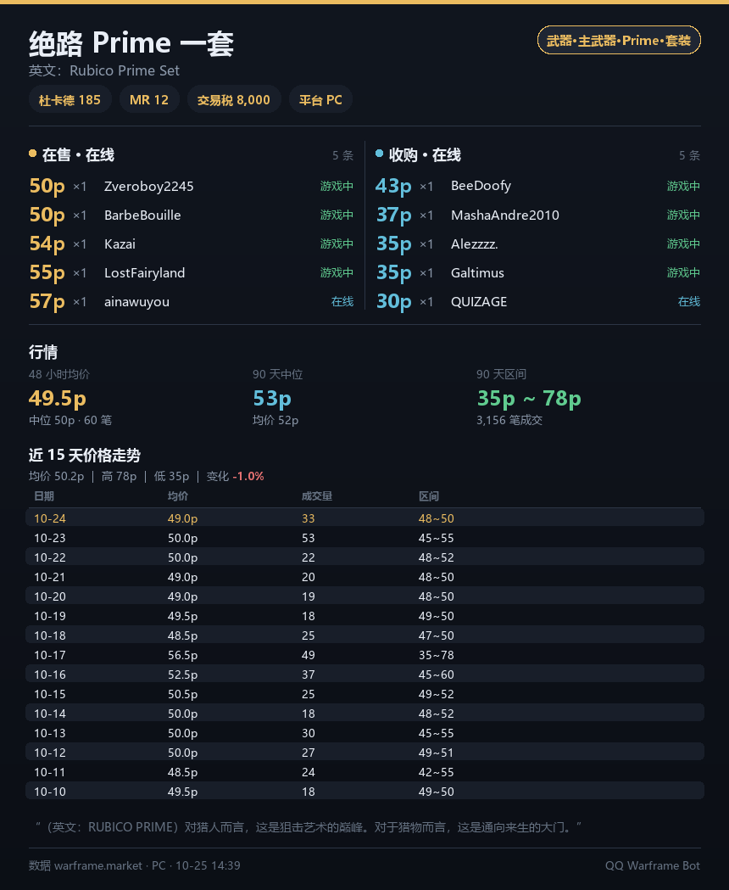

| 拆件比价 | 紫卡 |
| --- | --- |
| 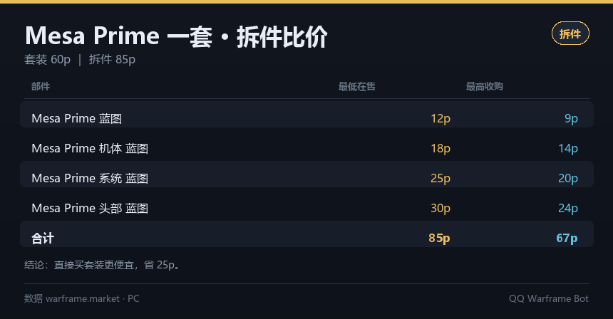 | 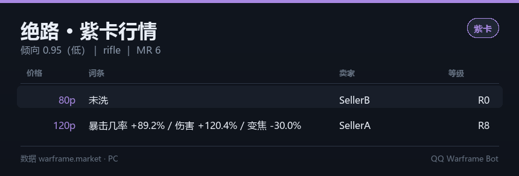 |

| 仲裁评级 | 仲裁任务 |
| --- | --- |
| 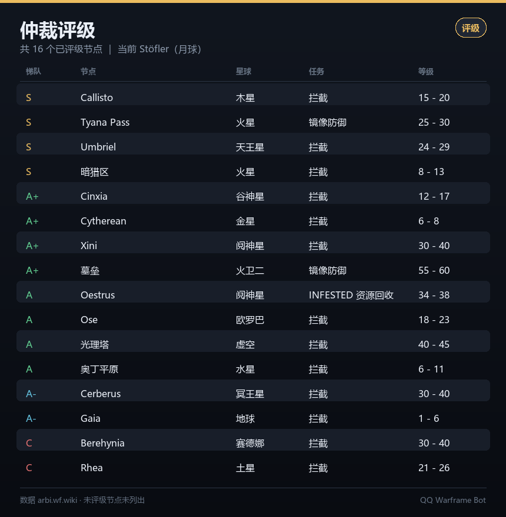 | 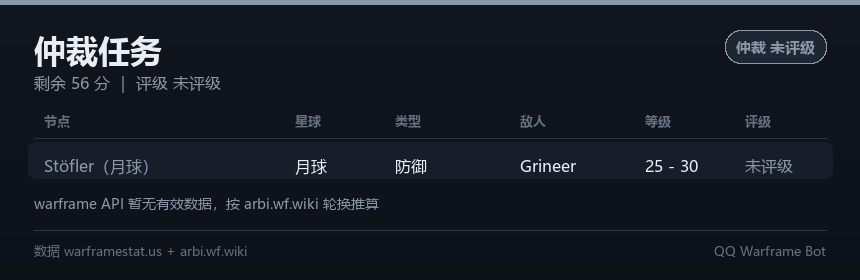 |

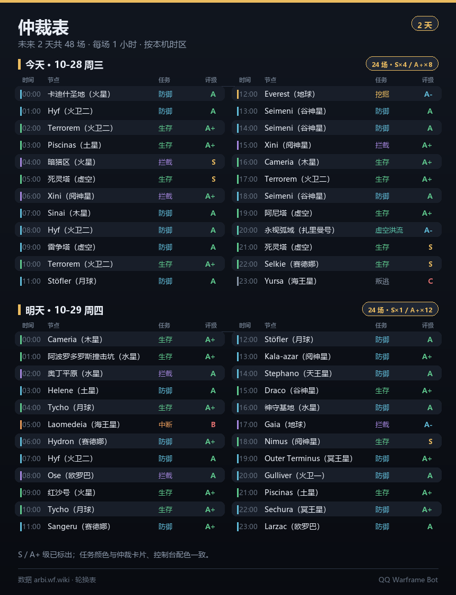

| 奸商 | 英文维基 |
| --- | --- |
| 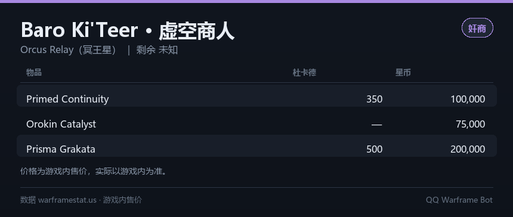 | 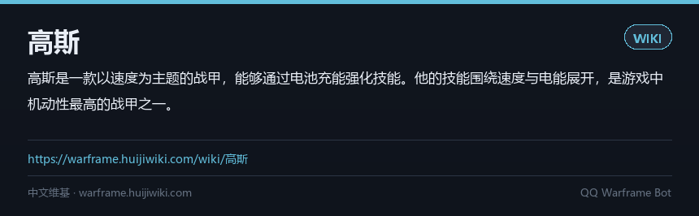 |

| 帮助菜单 | 完整世界状态 |
| --- | --- |
| 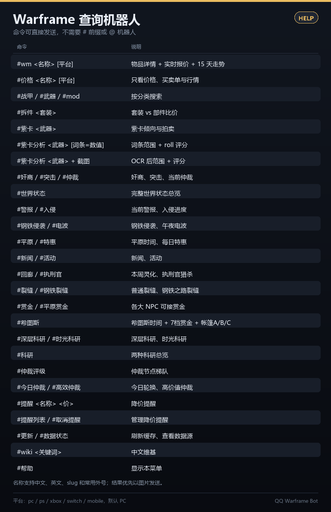 | 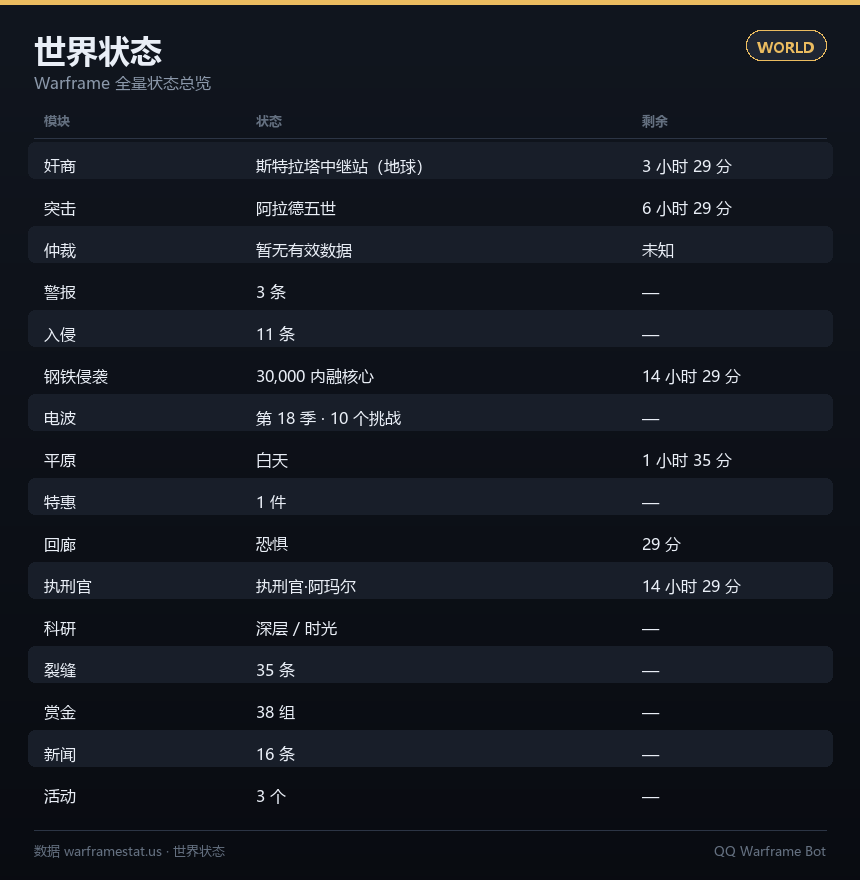 |

| Web 控制台 |
| --- |
| 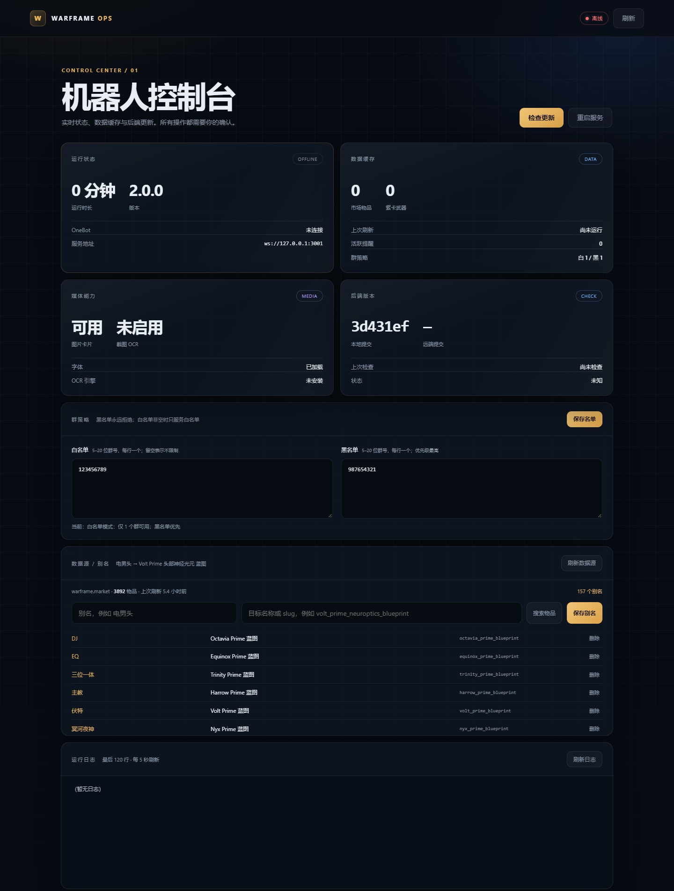 |

---

## 功能

| 模块 | 说明 |
| --- | --- |
| 物品查询 | 类型、杜卡德、MR、交易税、英文名、市场链接 |
| 实时报价 | 在线卖家/买家、价格、数量、MOD 等级、游戏内状态 |
| 成交行情 | 48 小时 / 90 天均价、中位价、区间、成交量，外加近 15 天逐日价格表 |
| 中文搜索 | 中文名、英文名、slug、外号、`绝路p` 简写 |
| 拆件比价 | 把套装拆成部件逐个查价，对比“买套 vs 买件” |
| 紫卡 | 武器倾向、紫卡类型、拍卖行在售（接口可用时） |
| 紫卡分析 | 本地计算词条范围与 roll 评分；支持文字词条和截图 OCR |
| 价格榜 | 金/银/铜垃圾地板价、Prime 战甲价格排行、最贵零洗紫卡榜；后台滚动扫描 + 本地快照，查询秒回 |
| 轮换商店 | 言录使（苦栓 · 每周 5 件）、埃尔戈·格拉斯（信条近战元素与加成）、埃莉诺（终幕武器 A/B 批）；wiki 玩家上报 + 本地快照 + 倒计时 |
| 世界状态 | Baro、突击、仲裁、警报、入侵、钢铁侵袭、电波、平原、希图斯、特惠、新闻、活动、回廊、执刑官、裂缝、虚空风暴、赏金 |
| 仲裁评级 | arbi.wf.wiki 的节点梯队（S/A+/A/A-/C）、当前节点评级、轮换兜底 |
| 仲裁表 | 未来 7 天完整排期（168 场），`#仲裁表 [天数]` 出图，控制台可折叠查看 |
| 多平台 | `pc / ps / xbox / switch / mobile` 价格 |
| 降价提醒 | 设定目标价，后台每 5 分钟检查并推送图片 |
| 事件订阅 | `#订阅 裂缝 生存`：新裂缝/风暴/仲裁/突击/回廊/轮换/警报/入侵/特惠一出现就推送到群 |
| 自动更新 | 后台每 6 小时刷新市场索引、紫卡武器表、仲裁评级 |
| Web 控制台 | `http://127.0.0.1:8080`：运行状态、缓存、日志、更新检查；更新前必须确认 |
| 更新提示 | 轮询 GitHub 新提交 + 监听本地 `bot/*.py` 变化，弹窗询问“是否更新/重启” |
| 短缓存 | 订单 60 秒、行情 15 分钟、世界状态 60 秒、维基 10 分钟，重复查询秒回 |
| 英文维基 | 英文摘要 + 中文翻译图片 + 直达 `wiki.warframe.com` 链接 |
| 稳定性 | 12h 物品缓存、3 请求/秒限流、429 重试、断线重连 |

---

## 命令

| 命令 | 作用 |
| --- | --- |
| `#wm <名称> [平台]` | 物品详情 + 买卖单 + 行情 + 近 15 天走势表（`#查` 仍可用） |
| `#价格 <名称> [平台]` | 只看价格：更多买卖单 + 行情 |
| `#战甲 / #武器 / #mod <名称>` | 分类搜索 |
| `#拆件 <套装名> [平台]` | 套装拆件比价 |
| `#金垃圾` / `#银垃圾` / `#铜垃圾` | 该杜卡特档位的最低在售、中位价、一组 6 个参考价 + 最便宜的部件 |
| `#垃圾` | 金/银/铜垃圾行情总览 |
| `#战甲榜` | Prime 战甲价格排行（最高 → 最低） |
| `#紫卡` | 当前最贵的零洗紫卡榜（最高 → 最低，每把武器取最贵的一口价） |
| `#紫卡 <武器名> [平台]` | 紫卡倾向 + 拍卖 |
| `#紫卡榜` | 同 `#紫卡`，显式写法 |
| `#紫卡分析 + 截图` | 自动识别武器、词条与负面，再计算范围 + 评分 |
| `#紫卡分析 <武器> [词条=数值 ...]` | 本地计算词条范围 + roll 评分 |
| `#奸商` | Baro 奸商位置、倒计时、库存 |
| `#突击` / `#仲裁` | 每日突击 / 当前仲裁（含节点评级） |
| `#今日仲裁` / `#高效仲裁` | 今日轮换 / 未来 24 小时 S/A 级仲裁 |
| `#仲裁表 [天数]` | 未来 7 天完整仲裁排期（每天一节、两列铺开，1 - 7 天可调） |
| `#世界状态` | 全量世界状态总览 |
| `#警报` / `#入侵` | 当前警报、入侵进度 |
| `#钢铁侵袭` / `#电波` | 钢铁侵袭、午夜电波挑战 |
| `#平原` / `#特惠` | 希图斯/福尔图娜/英择谛、每日特惠 |
| `#新闻` / `#活动` | 官方新闻、进行中的活动 |
| `#回廊` / `#执刑官` | 本周灵化、执刑官猎杀 |
| `#裂缝` / `#钢铁裂缝` | 普通裂缝 / 钢铁之路裂缝 |
| `#虚空风暴` / `#九重天` | Railjack 风暴裂缝（九重天） |
| `#赏金` / `#平原赏金` | 各大 NPC 可接赏金 |
| `#希图斯` | 希图斯昼夜 + 7 档 Ostrons 赏金 + 帐篷 A/B/C |
| `#深层科研` / `#时光科研` / `#科研` | 深层科研、时光科研、两者总览 |
| `#仲裁评级` | 仲裁节点梯队表（S/A+/A/A-/C） |
| `#轮换` | 言录使 / 埃尔戈·格拉斯 / 埃莉诺三个商店的当期货架与倒计时（商品全名、每把武器的元素与加成） |
| `#轮换 言录使` | 本周 5 件商品与苦栓价格（双衍王境 · 居住舱） |
| `#轮换 格拉斯` | 5 把信条近战的元素与加成（中继站 · 佩兰数列） |
| `#轮换 埃莉诺` | 当前批次的终幕武器与加成（霍瓦尼亚中央商场） |
| `#提醒 <名称> <目标价> [平台]` | 添加降价提醒 |
| `#提醒列表` | 查看本会话的提醒 |
| `#取消提醒 <编号\|all>` | 取消提醒 |
| `#订阅 <类型> [筛选词]` | 订阅世界状态事件，有新内容推送到本群（类型：裂缝/风暴/仲裁/突击/回廊/轮换/警报/入侵/特惠） |
| `#订阅列表` / `#取消订阅 <编号\|类型\|all>` | 查看 / 取消本群订阅 |
| `#更新` | 立即后台刷新所有缓存（含短缓存，10 分钟冷却） |
| `#数据状态` | 查看各数据源的条数与更新时间 |
| `#wiki <关键词>` | 英文维基摘要 + 中文翻译图片 + 链接；中文关键词（如 `电男`、`分裂膛室`、`钢铁之路`）自动映射成英文词条 |
| `#翻译 <物品名>` | 物品名中英双语对照 |
| `#帮助` | 指令菜单（图片） |

紫卡分析用法：

```text
#紫卡分析 + 紫卡截图                              自动识别武器、词条和负面
#紫卡分析 绝路 + 紫卡截图                         指定武器 + OCR
#紫卡分析 绝路                                   文字查看范围
#紫卡分析 绝路 伤害=165 多重=90                   文字范围 + roll 评分
```

- **只发图片即可**，武器名会从截图 OCR 里自动匹配；识别不到武器时仍会列出词条，并提示补发武器名。
- **识别怎么做准的**：同一张图会跑 6 套预处理（抹掉元素图标、灰度、4/6 倍放大、自动对比度、
  锐化、反色、两档二值化，外加单独裁出词条区再跑一遍），每套各出一份结果，按「词条 + 数值」
  加权投票合并——单次识别会丢负号、丢小数位，多套一起投就稳得多。
- 投票还定不了的（比如 `-79.3%` 被读成 `-19.3%`），再拿**这把武器自己的词条表和数值范围**
  兜底：2+ / 2+1 / 3+ / 3+1 四种配置各试一遍，全部数值都落在范围内才算数；配置本身还决定了
  哪条词条该是负的，比单看减号可靠。多认出来的词条、读错的数值会被这条规则筛掉。
- **正负按卡面符号来**：读到了 `+` / `-` 就按它算，数值范围不能推翻；只有符号彻底没读到
  （或读丢了减号），才按范围把方向补回来。
- **但「`-` 就是负面」不总成立**：后坐力这类属性有益方向本身就是负值——wiki 属性表里它的
  正面基础值写的就是 -90%，所以正面词条在卡面上显示成 `-105.0% 后坐力`；反过来 `+80% 后坐力`
  （后坐力变大）才是负面词条。程序按「这个槽位本该是什么号」判断，不是按正负判断。
- **歧视（对派系伤害）连符号都没有**：它在卡面上写成倍率，`x1.5 对Grineer的伤害` 是加伤、
  `x0.6` 才是减伤——**1.x 是正面、0.x 是负面**，不看 `+` / `-`。程序按倍率本身定正负，
  输出也照卡面写 `x1.5`（不换成 `+50%`）；OCR 把 `x` 读丢只剩 `1.5` 时同样按倍率解释。
  倍率只有一两位小数，反推成百分数会有 ±5 的误差，范围校验对这条词条单独放宽，
  不会因为这点偏差把它判成「套不上」。
- **词条顺序和卡面一致**：每份文本都记下某条词条排在词条第几位，取中位数排序，
  某一份预处理把行读反、漏读都不会把顺序带歪；输出不会按票数或词条名重排。
- 图片歪了也能认：先用行投影估出倾斜角（纯 PIL，几十毫秒），歪超过 2° 就直接转正再识别；
  还是认不全就再用 ±2° 补几组。歪得太多、字迹确实损失时，会明确写「图片倾斜约 N°，建议正着
  截图再发一次」，而不是硬给一个错值。
- 数值带负号表示负面，例如 `变焦=-30`（后坐力例外，见上）。
- 支持中文/英文词条名和常用缩写。
- 截图需要 Tesseract OCR；Docker 镜像已内置，Windows/直接运行需单独安装。

细节：

- 命令可以直接发送，例如 `wm 绝路`、`帮助`；也可以继续带 `#` / 全角 `＃`。
- 不再需要任何唤醒前缀，也不需要 @ 机器人。
- **唤醒只认独立的词**：`仲裁`、`回廊` 这种整条消息就是命令词才会响应；
  「仲裁什么时候刷新」「回廊怎么进」属于聊天，不会被当成查询。
  带参数的命令仍可连写（`wm绝路`、`查绝路`），但明显是句子的不接（`紫卡分析这个怎么样`）。
- `wm绝路` 这种不加空格的写法也能识别；普通聊天不会被当成物品查询。
- 平台写在名称最后：`wm 绝路 ps`、`价格 牛甲 xbox`，默认 PC。
- 名称支持中文、英文、外号；`绝路p`、`mesa p` 会当成 `prime`。
- 只有可交易物品才会出现在市场里（普通战甲本体、任务钥匙等不可交易）。

### 价格榜怎么跑

warframe.market 没有批量报价接口：垃圾/战甲要逐件查 `/v2/orders/item/{slug}/top`，
紫卡要逐把武器查 `/v1/auctions/search`，而且 Cloudflare 限流很紧（约 5 秒一次才稳）。
所以价格榜是**后台滚动扫描 + 本地快照**，命令只读快照、秒回：

```json
"board": {
  "enabled": true,
  "request_interval": 5.0,
  "junk_rarities": [100, 45],
  "junk_seconds": 14400,
  "frame_seconds": 14400,
  "riven_seconds": 28800
}
```

- 首次启动要把 345 件垃圾 / 51 套战甲 / 420 把紫卡武器扫完，三张榜共用一条队列，
  大约 1 小时出全量；期间发命令会告诉你还差多少、大概多久。
  各杜卡特档位轮流扫，金垃圾和银垃圾十几分钟内就各有十几件样本可用。
- 快照存在 `data/board_cache.json`，重启后接着用，不会从零开始。
- 被限流（429）会自动放慢到 20 秒一次并停 3 分钟，恢复后再慢慢提速。
- `junk_rarities` 里加 `15` 就是同时扫铜垃圾（多 196 件，首次扫描更久）。

### 轮换数据从哪来

三个商店 wiki 上都有专门词条，但都是**玩家手动上报**（没有官方接口），
所以周期自己算、内容必须抓：

| 商店 | wiki 词条 | 周期 |
| --- | --- | --- |
| 言录使 | `Acrithis/Current_Offerings` | 每周一 00:00 UTC（北京周一 08:00），5 件 |
| 埃尔戈·格拉斯 | `Tenet_Weapons` 的 `glast_tenet_melee_timer` 段 | 12 月 3 日 00:00 UTC 起每 4 天，5 把 |
| 埃莉诺 | `Coda_Weapons` 的 `eleanor_coda_timer` 段 | 3 月 18 日 00:00 UTC 起每 4 天换批，A/B 两批各 7 把 |

- 每 30 分钟抓一次，结果存 `data/rotation_cache.json`，重启接着用；抓取失败就继续用旧快照并标注「待抓取」。
- **`wiki.warframe.com` 对国内机房 IP 一律 403（Cloudflare）**，直连、换 UA、走代理都不通，
  所以默认用 `r.jina.ai` 中转取 wikitext；失败再退回直连 / Fandom 镜像，并记住上次成功的组合。
- 中文 wiki（huijiwiki / biligame）同样 403，抓不到中英对照，所以**信条 / 终幕武器的中文名是硬编码**的：

```json
"rotation": {
  "enabled": true,
  "refresh_seconds": 1800,
  "use_jina": true,
  "proxy": "http://127.0.0.1:10809"
}
```

- 新增武器时改 `bot/rotation.py` 里的 `TENET_MELEE`（信条近战）、`CODA_BATCHES`（终幕 A/B 批）、
  `ACRITHIS_ITEMS`（言录使商品 + 苦栓价）三张表即可，其他部分自动跟上。

---

## 快速开始

### 1. 环境

- Python 3.8+（你机器上已有 3.8.6）
- Pillow（已安装；若换机器：`pip install -i https://pypi.tuna.tsinghua.edu.cn/simple Pillow`）
- QQ 小号 + [NapCatQQ](https://github.com/NapNeko/NapCatQQ)（或 LLOneBot / Lagrange.OneBot）
- **代理**：默认使用 v2rayN 的 HTTP 代理 `http://127.0.0.1:10809`

### 2. 配置 NapCat

1. 启动 NapCat 并用小号登录。
2. 「网络配置」→ 新建 → **WebSocket 服务器**：
   - 端口 `3001`
   - Token 自定义（例如 `my-secret-token`），也可以留空
   - 消息格式 `array` / `string` 都兼容
3. 保存并启用。

### 3. 配置机器人

```bash
cd qqwarframe-bot
python run.py
```

（Windows 可双击 **`start.bat`**。）

第一次运行会生成 `config.json`。打开它，确认：

```json
"onebot": {
  "ws_url": "ws://127.0.0.1:3001",
  "access_token": "my-secret-token"
},
"warframe_market": {
  "proxy": "http://127.0.0.1:10809"
}
```

### 4. 自检

```bash
python selftest.py
```

（Windows 可双击 **`check.bat`**。）会依次检查：图片渲染、物品索引、中文名覆盖、
报价与行情、紫卡数据、紫卡分析、世界状态、中文维基。核心项全部 `OK` 即可启动；
维基如果被 Cloudflare/WAF 拦截会显示 `WARN`，不影响其他功能。

### 5. 启动

```bash
python run.py
```

看到 `已连接 OneBot 服务` 后，在群里发 `#帮助`。停止：`Ctrl + C`。

---

## Linux 部署

代码本身跨平台；Linux 提供 **一键部署（NapCat + Xray + 机器人）**、直接运行、
Docker、systemd 四种方式。项目里已经带了这些文件：

```text
deploy/oneclick.sh              # 一键部署（含 NapCat 与代理）
docker-compose.full.yml         # napcat + xray + bot
deploy/vless_to_xray.py         # VLESS 链接转 Xray 配置
xray/config.json                # 已按你的节点生成（含凭据，600）
install.sh  start.sh  check.sh
Dockerfile  docker-compose.yml  .dockerignore
deploy/qqwarframe-bot.service
deploy/docker-entrypoint.sh
```

### 方式 0：一键部署（NapCat + 代理 + 机器人）

```bash
sudo ./deploy/oneclick.sh
```

脚本会安装/启动 Docker、配置 **Docker 国内镜像加速**、生成 `.env`、
用 `deploy/vless.txt` 生成 `xray/config.json`，然后启动三个容器：

| 容器 | 作用 |
| --- | --- |
| `napcat` | QQ 协议端，WebUI `127.0.0.1:6099`，WS `3001`（仅容器网络） |
| `xray` | 你的 VLESS Reality 节点 → 本地 HTTP 代理 `10809`（仅容器网络） |
| `bot` | 机器人，连 `ws://napcat:3001`，走 `http://xray:10809`，Web 控制台 `8080` |

完成后按脚本提示：打开 WebUI 扫码登录 QQ → 确认 WS 服务器 3001 →
`docker compose -f docker-compose.full.yml logs -f bot` → 打开
`http://127.0.0.1:8080` → 群里发 `#帮助`。

### 国内加速

一键脚本会自动处理这些下载源：

| 项目 | 默认源 |
| --- | --- |
| Docker 镜像 | `docker.m.daocloud.io`、`docker.1ms.run`（写入 `/etc/docker/daemon.json`） |
| pip | `https://pypi.tuna.tsinghua.edu.cn/simple` |
| Docker 构建 apt | `mirrors.tuna.tsinghua.edu.cn` |
| Python 基础镜像 | 走 Docker 镜像加速，仍用 `python:3.11-slim` |

对应的 `.env` 变量：

```text
PIP_INDEX_URL=https://pypi.tuna.tsinghua.edu.cn/simple
APT_MIRROR=mirrors.tuna.tsinghua.edu.cn
DOCKER_MIRRORS=https://docker.m.daocloud.io,https://docker.1ms.run
```

想换回官方源，把对应变量改成：

```text
PIP_INDEX_URL=https://pypi.org/simple
APT_MIRROR=deb.debian.org
DOCKER_MIRRORS=
```

改完 `docker compose -f docker-compose.full.yml build --no-cache bot` 重建。
如果 `git clone github.com` 很慢，可临时用第三方加速前缀
`https://ghproxy.net/https://github.com/...`，但要注意第三方代理的代码完整性；
最稳妥仍是直连或先下载 Release 压缩包。

- WebUI 默认只绑 `127.0.0.1`，远程服务器用
  `ssh -L 6099:127.0.0.1:6099 root@服务器IP` 转发。
- 若在 NapCat WebUI 里设置了 WS Token，把它写进 `.env` 的
  `NAPCAT_WS_TOKEN=`，再重启 bot 容器。
- **`xray/config.json` 和 `deploy/vless.txt` 含节点凭据（权限 600），
  不要把压缩包或目录分享给别人。**
- 换节点：修改 `deploy/vless.txt` 后运行
  `python3 deploy/vless_to_xray.py --file deploy/vless.txt --output xray/config.json`，
  再 `docker compose -f docker-compose.full.yml restart xray`。

### 方式 A：直接跑（推荐先试）

```bash
# Debian / Ubuntu：Python、虚拟环境、中文字体
sudo apt update
sudo apt install -y python3 python3-venv fonts-noto-cjk

# Fedora：sudo dnf install python3 python3-pip google-noto-sans-cjk-fonts
# Arch：  sudo pacman -S python python-pip noto-fonts-cjk

cd qqwarframe-bot
chmod +x install.sh start.sh check.sh
./install.sh          # 建 .venv、装 Pillow、生成 config.json
nano config.json      # 填 ws_url / access_token / proxy
./check.sh            # 联网自检
./start.sh            # 启动
```

- 无桌面环境的服务器也能跑，图片由 Pillow 在本地画。
- 如果 `check.sh` 显示“图片渲染 FAIL”，就是缺中文字体，装 `fonts-noto-cjk`。
- 后台常驻用 `nohup`/`tmux` 也可以，但更推荐下面的 systemd。

### 方式 B：Docker（最省事）

```bash
cd qqwarframe-bot
mkdir -p config data logs
docker compose up -d --build
docker compose logs -f
```

- 默认 `network_mode: host`：容器里的 `127.0.0.1` 就是宿主机，
  NapCat 和代理都按本机地址填。
- 首次启动自动生成 `config/config.json`，可直接在宿主机编辑。
- 也可以用环境变量覆盖（优先级高于 json）：
  `QQWF_WS_URL`、`QQWF_ACCESS_TOKEN`、`QQWF_PROXY`、`QQWF_PLATFORM`、
  `QQWF_IMAGE`、`QQWF_ALERTS`、`QQWF_WORLDSTATE`、`QQWF_AUTO_UPDATE`、
  `QQWF_CACHE`、`QQWF_RIVEN_DISPOSITION`、`QQWF_ARBI_PROXY`、`QQWF_FONT`、
`QQWF_FONT_BOLD`、`QQWF_LOG_LEVEL`。
- 镜像内置 `fonts-noto-cjk`，不需要在宿主机装字体。
- 如果 NapCat 是同一 compose 里的另一个容器：删掉 `network_mode`，
  按 `docker-compose.yml` 注释启用 bridge 网络，`ws_url` 改成 `ws://napcat:3001`。

### 方式 C：systemd 常驻

```bash
sudo useradd -r -s /usr/sbin/nologin qqwarframe
sudo mkdir -p /opt/qqwarframe-bot
sudo cp -r . /opt/qqwarframe-bot
sudo chown -R qqwarframe:qqwarframe /opt/qqwarframe-bot
cd /opt/qqwarframe-bot && sudo -u qqwarframe ./install.sh

sudo cp deploy/qqwarframe-bot.service /etc/systemd/system/
sudo systemctl daemon-reload
sudo systemctl enable --now qqwarframe-bot
sudo journalctl -u qqwarframe-bot -f
```

服务文件默认用 `/opt/qqwarframe-bot/.venv/bin/python`，路径不同就改 `ExecStart`。

### Linux 上的 NapCat

NapCat 官方提供 Linux / Docker 版本。Docker 方式通常是：

```bash
docker run -d --name napcat --restart unless-stopped \
  --network host \
  -v "$PWD/napcat/config:/app/napcat/config" \
  mlikiowa/napcat-docker:latest
```

（镜像名和挂载路径以 NapCat 官方文档为准。）WebUI 默认 6099，登录后到
「网络配置」添加 WebSocket 服务器，端口 3001。

### Linux 上的代理

- v2rayA / Clash / sing-box 的 HTTP 端口不一定是 10809，
  改 `config.json` 里 `warframe_market.proxy`、`wiki.proxy`、`worldstate.proxy`。
- Clash 常见 `http://127.0.0.1:7890`；只给市场挂代理时其余填 `"none"`。
- Docker 用 host 网络时照常写 `127.0.0.1`；bridge 网络要写宿主机地址。
- 代理端口没监听时，`run.py` 启动会打印警告。

---

## Web 控制台

启动机器人后打开：

```text
http://127.0.0.1:8080
```

默认只绑定本机；Docker 映射为 `127.0.0.1:8080`。界面包含：

- 运行状态、OneBot 连接、版本、运行时长
- 市场物品数、紫卡武器数、上次数据刷新、活跃提醒
- 图片/OCR/字体状态
- 实时日志（最后 120 行）
- 本地/远端提交、检查更新、更新确认弹窗
- 群白名单/黑名单编辑，保存后立即生效
- 仲裁节点评级、**任务类型配色**（每种任务一个颜色，随时改）

### 群策略

页面下方的“群策略”面板：

- 白名单每行一个群号；**留空表示不限制**，非空时只服务名单内群；
- 黑名单每行一个群号，**永远拒绝，优先级最高**；
- 群号是 5–20 位数字，也支持逗号/空格分隔；
- 点“保存名单”会原子写回 `config.json`，**无需重启立即生效**；
- 机器人仍留在黑名单群里，只是不回复、不处理图片、不推送提醒。

### 任务配色

同一套颜色同时用在四个地方：**仲裁图片卡的主色条**、**控制台「仲裁评级」里每一行的底色**、
**「仲裁表」未来 7 天排期里每一场的底色**、**「任务配色」面板**。

- 仲裁列表每行按任务类型铺一层淡色底 + 左侧实色竖线，任务名本身也用该颜色加粗，
  顶部还有一条图例（这一屏出现过哪些任务、分别是什么颜色），扫一眼就能分出生存 / 防御 / 拦截；
- 行内格式跟数据源一致：`防御 - Infestation @ 卡迪什圣地, 火星`，第二行是节点号 · 等级 · 评级来源；
- **任务名后面那个小色块就是取色器**，点开改完立即保存并刷新，不用跑到下面的面板；
- 右侧评级标签按最终评级上色（S 金 / A+ 红 / A 橙 / A- 黄 / B 蓝 / C 灰）；
- 卡片主色也跟着任务类型走：生存绿 / 防御蓝 / 拦截紫 / 挖掘金 / 中断橙 …；
- “任务配色”面板里每种任务一行：左边取色器、中间任务名、右边当前色号，
  改过的行会标金色边框，鼠标悬停能看到默认色；
- 点“保存配色”写回 `data/mission_colors.json`，**下一次出图立即生效**，不用重启；
- 点“恢复默认”清掉所有改动；
- 想加新任务类型，直接在 JSON 的 `colors` 里加一条 `"任务名": "#RRGGBB"` 即可；
- 配置文件位置由 `arbi.mission_colors_file` 决定。

### 仲裁表（未来 7 天）

仲裁每小时换一个节点，`arbi.wf.wiki` 的轮换表能推算出未来任意时刻的完整排期。

- QQ 里发 **`#仲裁表`**（也可写 `#仲裁表 3` / `#未来仲裁`）：
  一张图列出**未来 7 天共 168 场**，每天一节、每天 24 场分成左右两列铺开，
  每场是「时间 / 节点（星球）/ 任务 / 评级」，任务格左侧的竖线用该任务的显示色；
- 小节标题右侧是本日统计，例如 `24 场 · S×6 / A+×6`，一眼能看出哪天值钱；
- 文字版每天只列最值得打的 **4 场**（S 优先、再按时间），剩下的概括成「另有 …，见图片」，
  7 天也只有 40 余行，不会刷屏；
- 天数支持 1 - 7，超出范围自动夹到 7，非数字按 7 处理；
- 控制台 **「仲裁评级」面板 → `仲裁表 · 未来 7 天` 页签**：同样的排期，按天折叠，
  今天默认展开，当前这一场带金色「进行中」标记，每行整行铺任务色，点一下标题展开当天全部 24 场；
- 控制台数据来自 `GET /api/arbi-schedule?days=7`，任务色取 `arbi.mission_colors_file`。

### 数据源 / 别名

页面下方的“数据源 / 别名”面板：

- 显示 **warframe market**、可交易物品数、上次刷新时间、别名数量；
- 完整目录 **3892 条可交易物品**：全部 / 战甲 255 / 武器 806 / 遗物 799 / 模组 1565 / 其他 467；
- 顶部按分类切换，支持名称/英文/slug 筛选和上一页/下一页；
- 每个战甲/物品行**最左边有 4 个别名输入框**，直接对应该战甲，可同时编辑多个叫法；
- 清空某个输入框并点该行“保存”，会移除该目标下的普通别名；内置别名会锁定保留；
- “新增别名组（4 个别名位）”在列表下方，用于给新目标建组；
- 点“搜索物品”会显示中文名、英文名和 slug；点“中英对照”直接翻译当前目标；
- 目标搜索框填物品名或 slug；保存后写入 `data/aliases.json`，并立即重载物品索引，**不用重启**；
- “刷新数据源”会重新拉取 warframe market 可交易物品索引；
- `wm` 默认实时刷新报价：每次查询绕过 60 秒订单缓存，直接取最新买卖单；可设
  `warframe_market.realtime_quotes: false` 恢复缓存模式。

战甲别名与部件后缀：

```text
wm 电男 / 电男p        → Volt Prime 一套
wm 电男蓝图            → Volt Prime 蓝图
wm 电男头 / 电男头部   → Volt Prime 头部神经光元 蓝图
wm 电男机体            → Volt Prime 机体 蓝图
wm 电男系统            → Volt Prime 系统 蓝图
```

- 参考表里的战甲中文别名已批量写入 `data/aliases.json`（牛甲、音妈、火鸡、咖喱、摸尸等）；
- 战甲基础别名指向该 Prime 战甲的**整套**（如 `忍者` → Ash Prime 一套）；
- 基础别名加 `蓝图` 指向**总图蓝图**（如 `忍者蓝图` → Ash Prime 蓝图）；
- 系统会根据整套自动展开 `头` / `头部` / `头部神经光元` / `机体` / `系统` 部件别名；
- 武器/守护/Archwing 套装同样生成部件，例如：`绝路枪管` / `绝路枪机` / `绝路枪托` / `绝路蓝图`；
- 目前数据源里共 **886 条别名**，包含 141 条整套别名、141 条蓝图别名、588 条部件别名和 16 条武器/Mod 别名；
- 附加 `p`（如 `电男p`）同样指向整套。

武器部件示例：

```text
wm 绝路枪管   → 绝路 Prime 枪管
wm 绝路枪机   → 绝路 Prime 枪机
wm 绝路枪托   → 绝路 Prime 枪托
wm 绝路蓝图   → 绝路 Prime 蓝图
```

所以：

```text
wm 电男头
```

会直接返回 `Volt Prime 头部神经光元 蓝图`，而不是再按模糊词搜索。

`#wm` 的订单/行情默认每次强制取最新；把 `warframe_market.realtime_quotes` 设为 `false` 可恢复 60 秒缓存。别名修改只影响搜索映射，不会清空行情缓存。

### 更新提示

机器人启动后会做两件事：

1. 每 10 分钟查一次 GitHub `commits/main`，**只有远端领先本地**时才提示更新；
2. 每 5 秒检查 `bot/*.py` 和 `run.py` 的修改时间，发现本地后端文件变化时提示重启。

检测到更新后：

- Web 顶部出现提示条，并弹出“是否更新/重启”确认框；
- 如果配置了 `web.update.notify_group` 或 `notify_user`，同时发 QQ 文字提示；
- 点“立即更新”后：
  - 源码目录（有 `.git`）执行 `git pull --ff-only`；
  - Docker/发布包（无 `.git`）自动下载 GitHub 最新源码包，备份旧 `bot/web`，
    替换代码但**保留 `config.json`、`data/aliases.json`、缓存、日志**，然后自动重启进程；
- 自更新失败会自动回滚并给出手动命令，不会把服务卡死。

Docker 更新（会写入当前 git commit）：

```bash
./deploy/update.sh
```

或手动：

```bash
BUILD_COMMIT=$(git rev-parse HEAD) \
  docker compose -f docker-compose.full.yml build
docker compose -f docker-compose.full.yml up -d
```

`deploy/build.sh` 会自动取 `.git` 的 HEAD；没有 `.git` 时读取发布包里的 `.build_commit`。不传 `BUILD_COMMIT` 重建会显示“本地版本未知”。

### .env 配置

一键部署会自动生成：

```dotenv
WEB_ADMIN_TOKEN=<随机令牌>
WEB_ADMIN_BIND=127.0.0.1
WEB_ADMIN_PORT=8080
BUILD_COMMIT=<部署时的 git commit>
```

- 远程访问时改 `WEB_ADMIN_BIND=0.0.0.0`，**必须同时设置强 token**；
- 浏览器首次打开会要求输入 `WEB_ADMIN_TOKEN`，保存在本机 localStorage；
- 不设置 token 时只建议 `127.0.0.1` 本机使用。

### config.json

```json
"web": {
  "enabled": true,
  "host": "127.0.0.1",
  "port": 8080,
  "token": "",
  "public_url": "",
  "log_lines": 200,
  "update": {
    "repo": "Dlessream/qqwarframe-bot",
    "branch": "main",
    "check_seconds": 600,
    "proxy": "",
    "notify_group": "",
    "notify_user": "",
    "self_update": true,
    "manual_command": "docker compose -f docker-compose.full.yml up -d --build"
  }
}
```

`public_url` 用于 QQ 更新提示里的控制台链接；不填则用 `host:port`。
`notify_group` / `notify_user` 留空时只在 Web 弹窗提示，不发 QQ。

---

## 代理说明（重要）

warframe.market 和 warframestat 在国内直连经常超时/403，**默认配置已经帮你挂好 v2rayN 的 HTTP 代理**：

```json
"warframe_market": { "proxy": "http://127.0.0.1:10809" },
"wiki":            { "proxy": "http://127.0.0.1:10809" },
"worldstate":      { "proxy": "http://127.0.0.1:10809" }
```

- 你的 v2rayN 必须处于运行状态，且「HTTP 代理」端口是 `10809`（v2rayN 默认）。
- 如果改过端口：把三处 `10809` 改成实际端口（例如 Clash 常用 `7890`）。
- 想强制直连（不走任何代理）：把 `proxy` 改成 `"none"`。
- 只给市场挂代理、维基直连也可以，把 `wiki.proxy` / `worldstate.proxy` 设为 `"none"`。

`selftest.py` 会显示当前使用的代理；如果报“无法连接”或 403，先确认 v2rayN 是否在运行。

---

## 配置项

### onebot

| 字段 | 默认 | 说明 |
| --- | --- | --- |
| `ws_url` | `ws://127.0.0.1:3001` | NapCat WebSocket 地址 |
| `access_token` | `""` | 与 NapCat Token 一致 |
| `reconnect_min_seconds` / `reconnect_max_seconds` | 1 / 60 | 断线重连退避 |
| `heartbeat_seconds` / `heartbeat_timeout_seconds` | 25 / 75 | 心跳与超时 |
| `api_timeout_seconds` | 15 | 发送接口超时 |

### behavior

| 字段 | 默认 | 说明 |
| --- | --- | --- |
| `prefixes` | `["#", "＃"]` | 兼容的命令前缀 |
| `require_prefix` | `false` | 是否强制带前缀；`false` 时命令可直接发送 |
| `allow_private` | `true` | 是否响应私聊 |
| `respond_to_at` | `true` | @机器人 可免前缀 |
| `at_sender` | `true` | 回复时 @ 提问者 |
| `whitelist_groups` | `[]` | 群白名单；**非空时只服务名单内的群** |
| `blacklist_groups` | `[]` | 群黑名单；**永远不服务，优先级高于白名单** |
| `cooldown_seconds` | 3 | 每用户冷却 |
| `max_replies_per_minute` | 20 | 每会话每分钟上限 |
| `max_reply_chars` | 1200 | 文字兜底分片长度 |
| `preload_items` | true | 启动预热物品索引 |

群策略示例：

```json
"behavior": {
  "whitelist_groups": ["123456789", "987654321"],
  "blacklist_groups": ["111111111"]
}
```

- 白名单非空：机器人只回应名单里的群，其他群完全静默；
- 黑名单：机器人仍留在群里，但不回复任何命令、@、图片，也不会推送降价提醒；
- 黑名单优先：同一个群同时在两个名单里也会被拒绝；
- 私聊不受这两个列表影响，由 `allow_private` 控制；
- 群号写成字符串或数字都可以，保存后重启机器人生效。

### warframe_market

| 字段 | 默认 | 说明 |
| --- | --- | --- |
| `base_url` | `https://api.warframe.market` | API 地址 |
| `language` | `zh-hans` | 物品语言 |
| `platform` | `pc` | 默认平台 |
| `crossplay` | true | 包含跨平台订单 |
| `max_requests_per_second` | 3 | 官方限制，别调高 |
| `retries` | 2 | 429/5xx 重试 |
| `proxy` | `http://127.0.0.1:10809` | 代理；`"none"` 直连 |
| `insecure_tls` | false | 证书异常时才开 |
| `cache_ttl_seconds` | 43200 | 物品索引缓存 12 小时 |
| `cache_file` | `data/items_cache.json` | 缓存路径 |
| `alias_file` | `data/aliases.json` | 外号表 |
| `top_orders` / `price_orders` | 5 / 8 | 卡片显示买卖单数 |
| `realtime_quotes` | true | `#wm` 每次强制取最新买卖单，绕过 60 秒缓存 |

### wiki

| 字段 | 默认 | 说明 |
| --- | --- | --- |
| `engine` | `english` | `english` 用官方英文 Wiki；`chinese` 保留旧 huijiwiki/BWIKI |
| `api_url` | `https://wiki.warframe.com/api.php` | 官方英文 Wiki MediaWiki API |
| `site_url` | `https://wiki.warframe.com/w/` | 词条链接前缀 |
| `language` | `en` | 请求英文内容 |
| `summary_chars` | 280 | 摘要字数 |
| `translate` | true | 英文摘要自动翻译成中文；失败时保留英文 |
| `translate_seconds` | 86400 | 翻译缓存秒数 |
| `proxy` | `http://127.0.0.1:10809` | **仅 Wiki 使用**的代理，不影响市场/世界状态 |
| `proxy_mode` | `auto` | `auto` 按顺序尝试；`custom` 只用 `proxy`；`direct` 强制直连；`system` 用系统代理 |
| `proxy_fallbacks` | `["none"]` | `auto` 模式下备选线路，`none` 表示直连 |
| `cookie` | `""` | 浏览器 Cookie（含 `cf_clearance`），用于绕过 Cloudflare |
| `fallback_fandom` | true | 官方 Wiki 被 Cloudflare 403 时，用 Fandom 英文镜像取正文 |
| `fandom_api` | `https://warframe.fandom.com/api.php` | Fandom 英文镜像 API |
| `fallback_bwiki` | false | 旧中文 BWIKI 兜底，默认关闭 |
| `bwiki_base` | `https://wiki.biligame.com/warframe` | 旧中文 BWIKI 地址 |

`#wiki` 返回**图片卡片**（标题、英文摘要、链接），文字回复同时附链接。官方 API 被 Cloudflare 拦截时，内容来自 Fandom 英文镜像，但卡片链接始终指向 `wiki.warframe.com`。

英文维基只有英文词条，所以中文关键词会先在本机换成英文名（`bot/zh2en.py`，不联网）：

1. 内置术语表：星球、派系、任务、集团、BOSS、资源、伤害类型、钢铁之路、执刑官、紫卡、电波等；
2. 物品索引：战甲/武器/MOD/赋能的中文名和俗称（`电男` → `Volt Prime Set`），来自 `data/items_cache.json` 与 `data/aliases.json`；
3. 自动去后缀：`Volt Prime Set` → `Volt Prime`，`... Neuroptics Blueprint` → `Volt Prime`；关键词没写 `P`/`圣装` 时先查普通版词条，写了才查 Prime 版。

命中映射时，卡片顶部会标一行「中文「电男」→ 英文词条「Volt」」，方便确认查的是哪个词条。

### worldstate

| 字段 | 默认 | 说明 |
| --- | --- | --- |
| `enabled` | true | 关闭后 `#奸商/#突击/#仲裁` 提示未启用 |
| `base_url` | `https://api.warframestat.us` | 世界状态 API |
| `language` | `zh` | 请求中文 |
| `proxy` | `http://127.0.0.1:10809` | 该站有 Cloudflare，建议走代理 |
| `official_url` | Warframe 官方 worldState | 裂缝等数据的官方备用源 |
| `official_proxy` | `none` | 官方 API 默认直连（代理可能 403） |
| `prefer_official_fissures` | true | 裂缝优先官方 ActiveMissions，失败回退 warframestat |
| `official_fallback` | true | warframestat 不可用时，用官方 CDN 拼出同结构数据 |
| `fallback_ttl_seconds` | 30 | 兜底数据缓存时间 |
| `fallback_cooldown_seconds` | 600 | 主源失败后多少秒内直接走兜底（避免每次都等超时） |
| `oracle_url` | `https://oracle.browse.wf` | 深层 / 时光科研的周常数据 |
| `oracle_proxy` | `none` | 周常数据默认直连 |

裂缝/钢铁裂缝会显示**全部当前有效条目**，不再截断前 15 条。官方源没有数据时自动回退 warframestat。

**官方兜底（`official_fallback`）**：`api.warframestat.us` 对数据中心 IP 返回 Cloudflare 403，
此时改用 `api.warframe.com/cdn/worldState.php`（直连可用）拼出同样结构的数据：

- 奸商、突击、警报、入侵、赏金、裂缝、深层/时光科研都会照常显示；
- 平原昼夜官方接口不含，按赏金到期时间本地推算（希图斯 100 分钟白天 / 50 分钟夜晚，
  英择谛与其同步，福尔图娜固定 1600 秒循环），结果与 warframestat 一致；
- 仲裁没有官方字段，自动按 arbi.wf.wiki 轮换表推算；
- 钢铁侵袭、午夜电波、无尽回廊、执刑官、新闻、每日特惠、虚空风暴这几项官方接口不提供，
  会明确显示「暂不可用」，不会伪造数据。

### 中文名（国服译名）

世界状态给的可选战甲、武器都是英文名（`Mesa`、`Vectis`），中文玩家看着别扭。
`bot/names.py` + `data/names_zh.json` 加了一层对照：

- **战甲**：116 条，取自灰机 wiki「战甲对比/发布日期」的**国服名称**列
  （`Mesa → 圣枪弥撒`、`Chroma → 怒炎龙骑`、`Atlas → 撼天刑者`），含 Prime / Umbra 与
  2026 年的新战甲（`Kullervo → 刀锋囚徒`、`Koumei → 御命织姬`）；
- **武器**：419 条，取自 warframe.market 紫卡武器接口的 `zh-hans` 译名
  （`Vectis → 守望者`、`Destreza → 技巧之剑`），Prime 武器按「圣装 + 基础名」拼；
- **战甲别名**：`data/warframe_alias.json` 存玩家日常叫法（`Mesa → 女枪`、
  `Chroma → 龙骑`、`Atlas → 土甲`），`#回廊` 的战甲那一栏写成 **别名（English）**，
  例如 `女枪（Mesa）`；圣装版按「别名 + P」（`Mesa Prime → 女枪P`）；
- **图片卡**：战甲写 `别名（English）`、武器写中文名，一行放得下，不会被省略号截断；
  文字兜底同样带上英文，方便对照 wiki 与交易站；
- 没收录别名的战甲退回 `卡利班（Caliban）` 这种「国服译名（English）」；
  查不到的条目原样保留英文，不瞎猜一个错的中文名。`#回廊` 用的就是这套。

### 紫卡分析

`#紫卡分析` 完全本地计算，不请求第三方紫卡站：

```text
#紫卡分析 + 紫卡截图
#紫卡分析 绝路 + 紫卡截图
#紫卡分析 绝路 伤害=165 多重=90
```

- 不带词条：显示 2/3 正向、2+1/3+1、负面的词条范围。
- 带文字词条：计算每个词条落在范围的百分比，并给出 roll 评分。
- 带截图：先 OCR 识别 `+165.2% 伤害`、`-30.5% 变焦`，再按文字词条同样计算范围 + 评分。
- 公式：`基础值 × random(0.90~1.10) × 紫卡倾向 × 配置权重`；倾向默认全局 1.20。
- **弹药效率**基础值 45%，同样套用上述公式；别名支持 `弹效`/`弹药效率`。
- 负面词条写成负值，例如 `变焦=-30`；截图里的 `x0.59` 倍率会换算成 `-41%`。

截图识别的三步（`bot/ocr.py` + `bot/rivenocr.py`）：

1. **多套预处理**：抹掉元素图标（高饱和像素涂成底色，否则 `🔥火焰伤害` 会读成乱码）→
   灰度 → 4/6 倍放大 → 自动对比度 → 锐化 → 反色（浅字压深底，反色后 Tesseract 明显更准）→
   两档二值化；再单独裁出下半部分词条区跑一遍。一套图出 6 份文本。
2. **投票合并**：逐行解析成 `(词条, 数值)`，同名同值的票累加；带正负号、词条名命中越长票力
   越高。小数点被读断（`102. 9%`）、后面多读一位（`92.1%6`）都会先归一化。
   每个读数还单独记一票「图上是 `+` 还是 `-`」，留给第三步定正负。
3. **范围校验 + 符号优先**：拿这把武器的 `2+ / 2+1 / 3+ / 3+1` 四种配置，枚举
   「用哪几条候选」逐一试算。**正负以卡面上的符号为准——`+` 就是正向、`-` 就是负向**，
   数值范围只用来在多个读数里挑出真正合规的那个（`-19.3` / `79.3` 里挑 `-79.3`、
   `492.1` → `92.1`）。四轮兜底，先保证不漏词条、再看可不可信：

   1. 听卡面符号，且数值要贴范围（正常情况）；
   2. 听卡面符号，数值对不上也照给——`-` 就是负的，只提示核对，绝不翻成正的；
   3. 符号一个都没读到，才退回按范围定正负；
   4. 连这样都不行，照实列出并提示核对原图。

   另外：不属于这把武器的词条会被剔掉；**同一条数值 + 同一个词族**（`暴击伤害` /
   `暴击几率` 被 OCR 读混）只能留一个，不会平白多出一条。对派系伤害走另一套规则：
   卡面是倍率（`x1.5` / `x0.6`），1.x 算正面、0.x 算负面，比对范围时留 ±5 的精度余量。

**没升满的紫卡**：卡面显示的是**当前等级**的数值，不是满级（Lv.8）的。
等级 0~8 对应满级的 `1/9 ~ 9/9`（线性递增），所以满级套不上时会按这个比例再试一遍，
认出「这张卡还没升满（约 Lv.N）」——数值照卡面输出，评分按换算后的 Lv.8 算。
之前一张 Lv.0 的斯特朗就是因为数值只有满级的 1/9，四条全都套不进范围，
结果既丢了负号又多出一条词条。

歪图：`deskew_angle()` 用行投影方差估倾斜角（纯 PIL，不要 numpy，几十毫秒），
`|角度| ≥ 2°` 时先把图转正再识别，认不全再补 ±2°。

OCR 依赖：

- Docker 镜像已内置 `tesseract-ocr` 和 `chi_sim` 中文包。
- 直接运行 Linux：`sudo apt install -y tesseract-ocr tesseract-ocr-chi-sim`。
- Windows：安装 [Tesseract](https://github.com/UB-Mannheim/tesseract/wiki)，
  加入 PATH，或用 `TESSERACT_CMD` 指定 `tesseract.exe` 的绝对路径。
- 没装 OCR 时文字词条仍可用；`#紫卡` 的倾向查询也不受影响。

### riven

| 字段 | 默认 | 说明 |
| --- | --- | --- |
| `disposition_override` | 1.2 | 所有武器的紫卡倾向统一按该值计算；`0` 表示使用市场实际值 |

### arbi

| 字段 | 默认 | 说明 |
| --- | --- | --- |
| `enabled` | true | 关闭后 `#仲裁评级` 提示未启用 |
| `base_url` | `https://arbi.wf.wiki` | 仲裁评级站点 |
| `proxy` | `http://127.0.0.1:10809` | 访问该站用；也支持直连 |
| `cache_seconds` | 21600 | 评级数据缓存（6 小时） |
| `mission_colors_file` | `data/mission_colors.json` | 任务类型显示色；控制台「任务配色」改的就是它 |

### image

| 字段 | 默认 | 说明 |
| --- | --- | --- |
| `enabled` | true | 关闭后全部发文字 |
| `font` / `font_bold` | `""` | 自定义字体路径；留空自动找雅黑/Noto/文泉驿 |

### alerts

| 字段 | 默认 | 说明 |
| --- | --- | --- |
| `enabled` | true | 降价提醒总开关 |
| `file` | `data/alerts.json` | 提醒持久化文件 |
| `check_seconds` | 300 | 检查间隔（最小 60 秒） |
| `max_per_chat` | 20 | 每个群/私聊最多条数 |

### subscriptions

| 字段 | 默认 | 说明 |
| --- | --- | --- |
| `enabled` | true | 事件订阅总开关（关闭后 `#订阅` 提示未启用） |
| `file` | `data/subscriptions.json` | 订阅持久化文件 |
| `check_seconds` | 120 | 世界状态轮询间隔（最小 60 秒） |
| `max_per_chat` | 20 | 每个群最多订阅条数 |
| `seen_limit` | 400 | 每条订阅记住多少个已推事件（去重窗口） |

### auto_update

| 字段 | 默认 | 说明 |
| --- | --- | --- |
| `enabled` | true | 后台自动更新总开关 |
| `interval_seconds` | 21600 | 刷新间隔（6 小时，最小 300 秒） |
| `on_start` | true | 启动后先做一次轻量刷新（用缓存/过期才拉） |
| `market` / `riven` / `arbi` | true | 分别控制三个数据源 |
| `manual_cooldown_seconds` | 600 | `#更新` 的冷却时间 |

实时数据每次查询会先走短缓存（见下节），过期后才重新请求；`#更新` 会同时清空短缓存。

### web

| 字段 | 默认 | 说明 |
| --- | --- | --- |
| `enabled` | true | Web 控制台总开关 |
| `host` | `127.0.0.1` | 监听地址；Docker 内由环境变量改成 `0.0.0.0` |
| `port` | 8080 | 控制台端口 |
| `token` | `""` | 访问令牌；非空时 API 必须带 `X-Admin-Token` |
| `public_url` | `""` | QQ 更新提示中显示的地址 |
| `log_lines` | 200 | 日志接口最多返回行数 |
| `update.repo` | `Dlessream/qqwarframe-bot` | GitHub 仓库 |
| `update.branch` | `main` | 分支 |
| `update.check_seconds` | 600 | 远程检查间隔（最小 60 秒） |
| `update.proxy` | `""` | 留空使用市场代理 |
| `update.notify_group` | `""` | 更新提示发到哪个群 |
| `update.notify_user` | `""` | 更新提示发到哪个 QQ |
| `update.self_update` | true | 无 `.git` 环境允许后端下载源码并自动重启；`false` 只提示手动命令 |
| `update.manual_command` | Docker build 命令 | 自更新失败时显示的手动更新命令 |

环境变量：`QQWF_WEB`、`QQWF_WEB_HOST`、`QQWF_WEB_PORT`、`QQWF_WEB_TOKEN`。

### cache

| 字段 | 默认 | 说明 |
| --- | --- | --- |
| `enabled` | true | 短缓存总开关 |
| `item_seconds` | 3600 | 物品详情缓存 |
| `orders_seconds` | 60 | 买卖单缓存 |
| `stats_seconds` | 900 | 48h/90 天行情缓存 |
| `riven_seconds` | 300 | 紫卡拍卖缓存 |
| `worldstate_seconds` | 60 | 奸商/突击/仲裁缓存 |
| `wiki_seconds` | 600 | 维基词条缓存 |

想每次都拿最新数据，把对应秒数改成 `0` 即可关闭该项缓存；`#更新` 会立即清空所有短缓存。

---

## 图片卡片

- 用 Pillow 现画，不依赖浏览器或外部服务；宽度固定 860px，高度自适应。
- 中文字体自动查找：微软雅黑（`msyh.ttc`）→ 黑体（`simhei.ttf`）→ Noto/文泉驿；
  Linux 还会走 `fc-match` 和 `/usr/share/fonts` 全目录扫描。
  找不到字体或 Pillow 时会自动**退回文字**，不会导致机器人崩溃。
- 图片以 `base64://` 形式通过 OneBot 发送，NapCat 在 Docker 里也能收到。
- 想换字体：把 ttc/ttf 路径填到 `image.font` / `image.font_bold`。

---

## 降价提醒

```text
#提醒 绝路 50          → 目标价 ≤ 50p（PC）
#提醒 Mesa ps 80        → PlayStation，目标 ≤ 80p
#提醒列表
#取消提醒 ab12
```

- 后台每 5 分钟检查一次，**达到目标价时推送一张图片卡片**，然后自动关闭该条提醒。
- 提醒保存在 `data/alerts.json`，重启机器人不丢。
- 每个会话最多 20 条；同一物品同一平台不能重复添加。
- 检查请求也受 3 次/秒限流保护。

---

## 事件订阅

`#提醒` 盯的是**价格**，`#订阅` 盯的是**世界状态事件**：新的裂缝、新的虚空风暴、
仲裁换节点、突击刷新、回廊换灵化、轮换商店更新、新警报/入侵、每日特惠，
一出现就推送到订阅的那个群。

```text
#订阅 裂缝             → 新裂缝都推
#订阅 裂缝 生存        → 只推「生存」任务（筛选词按卡面中文匹配：节点/任务/遗物等级/敌人）
#订阅 仲裁
#订阅 风暴 冥王
#订阅列表
#取消订阅 裂缝         → 按类型取消（也可写编号或 all）
```

- 类型：`裂缝` / `虚空风暴`（九重天）/ `仲裁` / `突击` / `回廊` / `轮换` / `警报` / `入侵` / `特惠`。
- `#订阅`（不带参数）和 `#订阅列表` 都会回一整块说明：九类订阅一次列全，
  每类写清推什么、能筛什么，最后附上本群的订阅清单（没有就是「本群目前没有订阅。」）。
- 后台每 2 分钟检查一次世界状态；**同一个事件只推一次**（按事件 ID 去重，记录落盘）。
- 新建订阅时会把当前已经存在的内容记为「已见」，不会一订阅就刷一屏；
  机器人重启后的第一轮也只重建基线，不补推。
- 群维度：在哪个群订阅就推到哪个群；群黑白名单同样生效。
- 订阅保存在 `data/subscriptions.json`，重启不丢；每个群最多 20 条。

---

## 测试

```bash
python -m unittest discover -s tests -t . -v
```

**595 个离线测试**，不联网、不连 QQ，覆盖：

- WebSocket 握手/掩码/分片/ping-pong
- 中文/英文/外号搜索排序、平台参数、拆件与紫卡逻辑
- 世界状态解析、官方/ warframestat 裂缝回退、全部裂缝不截断、钢铁裂缝、虚空风暴/九重天、赏金、希图斯 7 档赏金/帐篷 A-C、深层/时光科研、紫卡范围/roll 评分/OCR/武器自动解析/负面符号合并
- 仲裁评级 JSON 解析、节点查找、轮换兜底、未来 7 天排期（168 场 / 天数夹取）
- 市场响应解析、48h 统计聚合、缓存、429 重试
- 维基摘要与 HTML 回退、Wiki 专用代理线路切换、世界状态时间解析
- 提醒存储的增删改查与持久化
- 自动更新调度、手动触发冷却、数据源状态汇总
- 群黑白名单、黑名单优先级、私聊不受影响
- 无前缀命令解析、普通聊天不误触发
- Web 控制台鉴权/状态/更新 API、GitHub 提交方向比较、本地代码变化检测、缺失本地提交时的远端提示、无 `.git` 源码包自更新与数据保留
- Web 群策略编辑、配置持久化、`/api/arbi-schedule` 天数参数
- 别名表读写/批量 4 别名、整套/蓝图双别名、分类分组、所有战甲与武器套装部件后缀、warframe market 可交易物品搜索与索引热重载
- `#wm` 实时报价强制刷新、分类判定
- `#翻译` 中英双语对照、Web 翻译接口
- 短 TTL 缓存的命中/过期、各数据源缓存包装
- 图片卡片的 PNG 尺寸与长文本换行、仲裁表两列排布高度
- **端到端**：mock OneBot 服务端 + mock 市场/Wiki，验证收事件、发图片、@ 回复

---

## 目录结构

```text
qqwarframe-bot/
├── run.py                 # 启动入口
├── selftest.py            # 联网自检
├── config.example.json    # 配置模板
├── start.bat / check.bat  # Windows 快捷方式
├── start.sh  / check.sh   # Linux / macOS 快捷方式
├── install.sh             # Linux 一键安装（venv + Pillow + 配置）
├── Dockerfile             # Linux 容器镜像（内置中文字体）
├── docker-compose.yml     # 只起机器人（用宿主机代理/NapCat）
├── docker-compose.full.yml # 一键：napcat + xray + bot
├── deploy/
│   ├── oneclick.sh              # 一键部署脚本
│   ├── vless_to_xray.py         # VLESS 链接转 Xray 配置
│   ├── vless.txt                # 你的节点链接（含凭据，600）
│   ├── qqwarframe-bot.service   # systemd 单元
│   └── docker-entrypoint.sh     # 容器入口
├── xray/config.json       # 生成的 Xray 配置（含凭据，600）
├── napcat/                # 一键部署后 NapCat 的 QQ 数据
├── data/
│   ├── aliases.json       # 外号表（可编辑）
│   ├── items_cache.json   # 物品缓存（运行后生成）
│   ├── alerts.json        # 降价提醒（运行后生成）
│   ├── subscriptions.json # 事件订阅（运行后生成）
│   └── mission_colors.json # 任务配色（改过才生成）
├── docs/                  # 效果图
├── bot/
│   ├── config.py          # 配置（含 QQWF_* 环境变量覆盖）
│   ├── log.py             # 日志
│   ├── net.py             # HTTP（代理/gzip/重试/certifi）
│   ├── cache.py           # 短 TTL 缓存
│   ├── ws.py              # RFC6455 WebSocket
│   ├── onebot.py          # OneBot 11（文字/图片）
│   ├── market.py          # 市场 API、搜索、行情、拆件
│   ├── riven.py           # 紫卡
│   ├── rivencalc.py       # 紫卡词条基础数据与别名
│   ├── arbi.py            # 仲裁评级（arbi.wf.wiki）
│   ├── missioncolors.py   # 任务类型显示色（仲裁卡片上色，可在控制台改）
│   ├── updater.py         # 后台自动更新（市场/紫卡/分析）
│   ├── worldstate.py      # 奸商/突击/仲裁
│   ├── alerts.py          # 降价提醒存储
│   ├── subscriptions.py   # 事件订阅存储 + 世界状态轮询推送
│   ├── imagecard.py       # Pillow 卡片绘制（自动找中文字体）
│   ├── present.py         # 数据 → Reply（图片 + 文字兜底）
│   ├── render.py          # 文字排版
│   ├── replies.py         # Reply 数据结构
│   ├── commands.py        # 命令解析与路由
│   ├── update.py          # GitHub/本地代码更新检查
│   ├── web.py             # 零依赖 Web 控制台
│   └── app.py             # 过滤、限流、发送、提醒循环
├── web/                   # 控制台 HTML / CSS / JS
├── tests/                 # 595 个测试 + fixtures
└── logs/                  # 运行后生成
```

---

## 常见问题

**1. 所有查询都报“无法连接” / 代理错误**

v2rayN 没开，或端口不是 10809。启动 v2rayN，或在 `config.json` 里改
`warframe_market` / `wiki` / `worldstate` 三处 `proxy`；
也可以临时改成 `"none"` 直连试试。

**2. 图片变成文字了**

说明 Pillow 或中文字体不可用。运行 `python -c "import PIL"` 检查；
没有就 `pip install -i https://pypi.tuna.tsinghua.edu.cn/simple Pillow`。Windows 自带微软雅黑；Linux 装 `fonts-noto-cjk`，或 `QQWF_FONT=/path/to/font.ttc` 指定。

**3. 奸商/突击 403 或被 Cloudflare 拦截**

`api.warframestat.us` 对部分网络会拦。确认 `worldstate.proxy` 走代理；
如果仍失败，`#查`、`#拆件` 等功能不受影响。

**4. 紫卡没有拍卖价格**

紫卡拍卖使用官方：

```text
/v1/auctions/search?type=riven&weapon_url_name=<weapon>&buyout_policy=direct&sort_by=price_asc
```

如果官方改版导致 404/403，机器人仍展示**武器倾向、类型、MR**，并明确提示接口暂不可用。拍卖缓存默认 5 分钟。

**5. `#wiki` 提示被 Cloudflare 拦截（403/567）**

`wiki.warframe.com` 会拦截部分网络/机房 IP。处理顺序：

1. 先用浏览器打开 `https://wiki.warframe.com/w/Volt`。如果浏览器能开、
   机器人不行，说明是 Cloudflare 拦了脚本请求。
2. 机器人会自动改用 Fandom 英文镜像取正文，卡片链接仍指向
   `https://wiki.warframe.com/w/...`；如果 Fandom 也不可用，才会返回“未找到”卡片。
3. 想强制走官方源：在浏览器里按 F12 → Network → 刷新词条 → 复制 `Cookie`
   （含 `cf_clearance`），粘贴到 `config.json` 的 `wiki.cookie`；
   同时保持 `wiki.user_agent` 与浏览器一致（默认 Chrome UA）。
4. 也可以换一个能过验证的代理（`wiki.proxy`），或把
   `wiki.proxy_mode` 设为 `direct` 试试直连；`auto` 会先走代理、
   失败后自动尝试 `proxy_fallbacks`（默认 `none`）。
5. 失败卡片和文字回复都会附上官方搜索链接，至少能手动打开。

**6. 中文名全是英文**

`selftest.py` 会显示中文名条数。为 0 时检查 `language` 是否为 `zh-hans`、
代理是否正常。中文名来自接口的 `Language: zh-hans` 响应头。

**7. 429 太频繁**

保持 `max_requests_per_second: 3`，把 `cooldown_seconds` 调大；
拆件/提醒会额外请求，属于正常现象。

**8. 提醒一直不触发**

提醒只对比**在线卖家的最低在售价**；价格没到目标就不会推送。
用 `#提醒列表` 看“当前”价。检查间隔默认 5 分钟。

**9. 会不会封号**

使用 NapCat 这类第三方协议端存在风控可能。请用小号、控制频率、
不要发广告或 @全体。默认配置已经比较保守。

**10. `#紫卡分析` 提示未识别**

- 文字词条和截图都支持；文字格式如 `伤害=165 多重=90`。
- 截图需要 Tesseract 与 `chi_sim` 中文包；Docker 镜像已内置。
- 截图尽量只保留紫卡词条区域，避免把整个屏幕截进去。
- 查不到武器时先用 `#紫卡 <武器>` 确认市场有该紫卡。

**11. Web 控制台打不开 / 一直 401**

- 默认只绑 `127.0.0.1:8080`；远程服务器用 SSH 隧道，或改
  `WEB_ADMIN_BIND=0.0.0.0` 并设置强 `WEB_ADMIN_TOKEN`。
- 401 表示令牌不对：在页面里重新输入 `.env` 的 `WEB_ADMIN_TOKEN`。
- Docker 端口被占用时改 `.env` 的 `WEB_ADMIN_PORT`，然后
  `docker compose -f docker-compose.full.yml up -d`。

**12. 更新提示一直不出现**

- 源码运行需要 `.git` 或 `.build_commit` 才能识别本地版本；发布包在打包时会写入。
- Docker 重建时必须带 `BUILD_COMMIT`（用 `./deploy/build.sh` 或
  `BUILD_COMMIT=$(git rev-parse HEAD) docker compose ... build`），
  否则会提示“本地版本未知”；设置 `QQWF_COMMIT` 环境变量也可以。
- GitHub API 被墙时给 `web.update.proxy` 配代理（留空会复用市场代理）。
- 只有**远端领先本地**才提示；本地未推送的提交会显示“本地未推送”，不会提示降级。
- 本地改完 `bot/*.py` 后，控制台应在 5–10 秒内弹出“是否重启”。

---

## 数据来源与合规

- 市场数据来自 warframe.market 官方 API v2（`/v2/items`、`/v2/item`、
  `/v2/orders/item/{slug}/top`、`/v1/items/{slug}/statistics`、`/v2/riven/*`），
  官方限制约 3 请求/秒，本项目内置限流与 12 小时缓存。
- 世界状态来自 warframestat.us；英文维基首选 `wiki.warframe.com`，Cloudflare 拦截时自动用 Fandom 英文镜像取正文，回复和图片始终保留官方链接。
- 市场索引、紫卡武器表、仲裁评级由后台按 `auto_update.interval_seconds` 自动刷新；买卖单/行情/世界状态/维基走 `cache` 里的短 TTL，过期后重新请求。
- 紫卡截图 OCR 使用本机 Tesseract，不上传图片；识别结果仅用于本次回复。
- 仲裁评级来自 [arbi.wf.wiki](https://arbi.wf.wiki/) 的公开 JSON（梯队、节点、轮换表），回复保留原链接。
- 本项目为个人学习项目，与 Digital Extremes、warframe.market、bilibili 均无关联。
  请勿用于商业用途或大规模抓取。

---

## License

仅供学习交流使用。你可以自由修改、自用；转载请注明数据来源。


